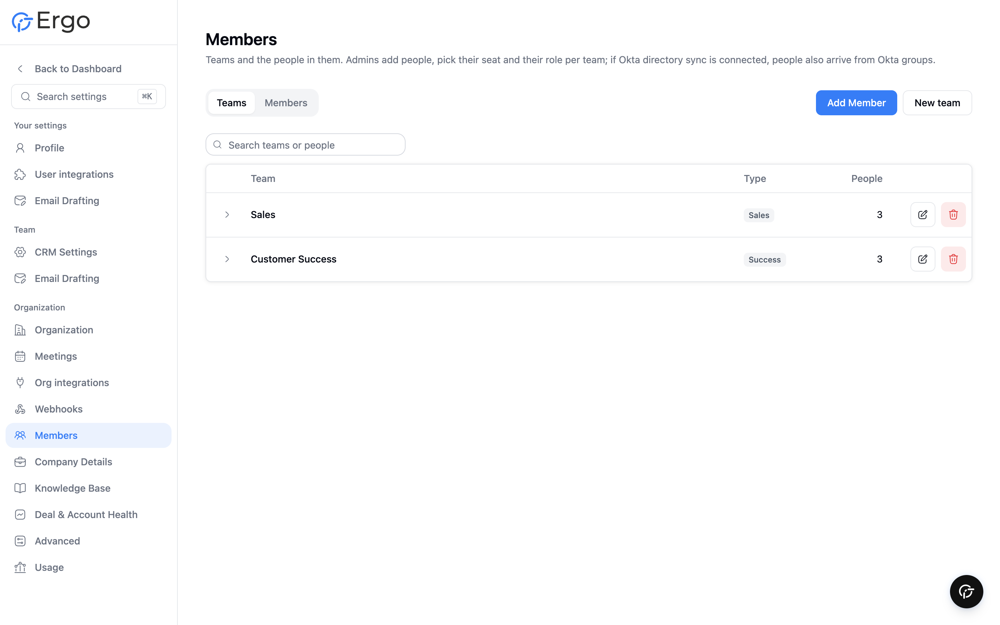

Teams decide who an Admin can manage, and which meetings and settings a person can reach. Change teams with care.

## Who can use this

- An **Owner** can create and delete teams.
- An Owner, or an **Admin** of that team, can edit a team.

## Before you start

- Decide the team name, an optional description, the team type, and the team Admin.
- Make sure that the person who will be the team Admin already has an Ergo account in your organization. The person does not need to be an Admin of a different team.

## Steps

1. Open **Settings** → **Members** and click the **Teams** tab.
2. To create a team (Owner only), click **New team**.
3. Enter the **Name**, an optional **Description**, the **Type**, and the **Admin**. Click **Create team**.
4. To edit a team, click the pencil icon (**Edit team**) in the team row. Change the **Name**, **Description**, or **Type**. Click **Save team**.
5. To delete a team (Owner only), click the trash icon (**Delete team**) in the team row.
6. If the dialog lists people who belong only to this team, select a different team for each person.
7. Type the team name. Click **Delete team** or **Move people and delete team**.
8. To put people in the team, click **Add Member** (new account). Or open a person and click **Add to team** (existing account, Owner only).

## What to expect

- Use the **Description** to explain the function of the team (500 characters maximum). Ergo does not fill this field.
- Each person keeps the Admin or Member role in the new team after a delete.
- You cannot delete the last team, or a team that is linked to an Okta group.
- A delete also deletes the email templates and the reporting fields of that team.
- Editing a team does not move members and does not grant reporting access.

## Common issues

- You do not see **New team**: only an Owner sees it.
- You cannot edit a team: you are not an Owner or an Admin of that team.
- The delete is blocked: the team is the last team, or it is linked to an Okta group.
- A new team has no people yet: add members, then check reporting access and CRM settings.

## Related articles

- [Organization and team hierarchy](https://support.joinergo.com/articles/9009087843)
- [Provision accounts](https://support.joinergo.com/articles/4601303031)
- [Add, remove or move members](https://support.joinergo.com/articles/2381379700)
- [Change a role or seat type](https://support.joinergo.com/articles/9544077862)
- [Seats, roles and visibility](https://support.joinergo.com/articles/6821509431)
