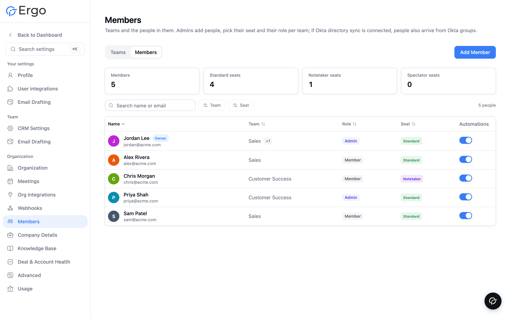

Both grants are in the dialog of the person on **Settings** → **Members**. They are independent. Meeting access does not open Reporting. Reporting access does not open meetings.

## Who can use this

- **Meeting access:** an Owner (anyone in the organization), or an Admin of a team that the person belongs to (people in the teams that Admin manages). You cannot edit your own.
- **Reporting access:** an Owner. Admins already have Reporting when it is on for your organization.

## Grant meeting access

By default a Member sees the meetings that the Member owned or attended. A team Admin also sees every meeting of the teams that Admin manages. An Owner sees everything. A grant adds the people whose meetings this person can also see.

1. Open **Settings** → **Members** and click the person.
2. Find **Meeting access**. It shows the current state: *Only their own meetings*, *Also sees …*, *Everyone can see all meetings*, or *All meetings in the organization* (the Owner).
3. Click **Edit**.
4. In **Whose meetings can [name] see?**, search and tick people, or use **Select all**.
5. Click **Save access**. Tell the person to refresh the page.

Private meetings are never included. A private meeting is visible only to its owner and attendees. For one recording outside the rules, use **Share** on the meeting or a shared folder.

For organization-wide visibility, use [Everyone can see all meetings](https://support.joinergo.com/articles/1532088538).

## Grant reporting access

1. Open **Settings** → **Members** and click the person.
2. Find **Reporting access**. Click **Grant** (or **Edit** if the person already has access).
3. Select **All dashboards** or **Specific dashboards**.
4. If necessary, select **Can create dashboards, fields, and rubrics**.
5. Click **Grant access**.

To change the scope, click **Edit**, change the selection, and click **Save access**. To remove the access, click **Edit**, then **Revoke access**, then **Confirm revoke**.

If Reporting is not available to anyone in your organization, contact Ergo support.

## Common issues

- **Meeting access shows "Everyone can see all meetings" and you cannot edit it.** The organization setting is on. You do not need individual grants.
- **A manager cannot find a rep's meeting in the per-person filter.** Grant the manager access to that rep, or make the manager an Admin of the rep's team.
- **The person sees meetings but not Reporting.** Add a Reporting access grant. It is separate.

## Related articles

- [Seats, roles and visibility](https://support.joinergo.com/articles/6821509431)
- [Everyone can see all meetings](https://support.joinergo.com/articles/1532088538)
- [Meeting availability and visibility](https://support.joinergo.com/articles/9550556881)
- [Share, revoke, or password-protect meetings](https://support.joinergo.com/articles/7720202645)
- [Meeting history and folders](https://support.joinergo.com/articles/7669432836)
