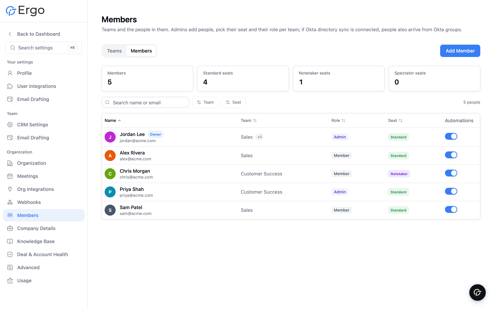

An organization has teams. Each person has a role in a team and a seat. This article shows where to manage them.

## The model

- **Organization**: your company. It has one main owner and can have more owners. Each owner has the **Owner** label in **Settings** → **Members**.
- **Teams**: groups inside the organization. Each team has a type: sales, implementation, success, partnerships, growth or marketing, product. A person can belong to several teams and has one primary team.
- **Role in team**: **Admin** or **Member**. An Admin manages that team: edits it, adds people to it, turns Automations on or off for its people, and edits whose meetings they can see.
- **Seat**: **Standard**, **Notetaker**, or **Spectator**. The seat decides which features the person can use. You set it per person, independent of role.

## Where to manage things

- **Settings** → **Members**, tab **Teams**: click a team to expand it. The list shows each person with **Role**, **Seat**, and the **Automations** switch.
- **Settings** → **Members**, tab **Members**: all the people with their team, role, seat, and **Automations** switch. It also shows the totals **Members**, **Standard seats**, **Notetaker seats**, and **Spectator seats**.
- Click a person to see **Memberships**, **Connections**, and the access settings.
- **Add Member**: for an Owner or a team Admin. **New team**: for an Owner.
- **Settings** → **Organization** (Owner only): **CRM**, **Organization owners**, **Pipeline access**, and, if your organization has it, **Okta directory sync**.
- **Settings** → **Meetings** (Owner only): **Everyone can see all meetings**, **Allow internal attendees to delete the meeting**, and **Meeting Privacy Rules**.
- **Settings** → **Usage** (Owner only): the included agent usage of each person, and the extra usage in this billing cycle. If usage billing is not on, the page shows "Usage isn't turned on for your organization."

## Rules to remember

- Each person can see the **Members** tab. A Member sees it read-only. Only an Owner or a team Admin can make changes. A team Admin can make changes only for the people in that Admin's teams.
- An Owner can make a team Admin an owner, or remove an added owner. Open **Settings** → **Organization** → **Organization owners** → **Manage**. Only Ergo support can change the main owner.
- A person must be in at least one team.
- Team Admins see the meetings of their teams' members. Members see only their own meetings unless you grant more.
- Memberships from Okta directory sync have the label **Managed by Okta**. To remove the person from that team, remove the person from the Okta group. An Owner can change the role in Ergo.

## Related articles

- [Seats, roles and visibility](https://support.joinergo.com/articles/6821509431)
- [Create/edit/delete teams](https://support.joinergo.com/articles/7682487269)
- [Add, remove or move members](https://support.joinergo.com/articles/2381379700)
- [Grant meeting or reporting access](https://support.joinergo.com/articles/3277963384)
- [Permission or access denied](https://support.joinergo.com/articles/4190135592)
