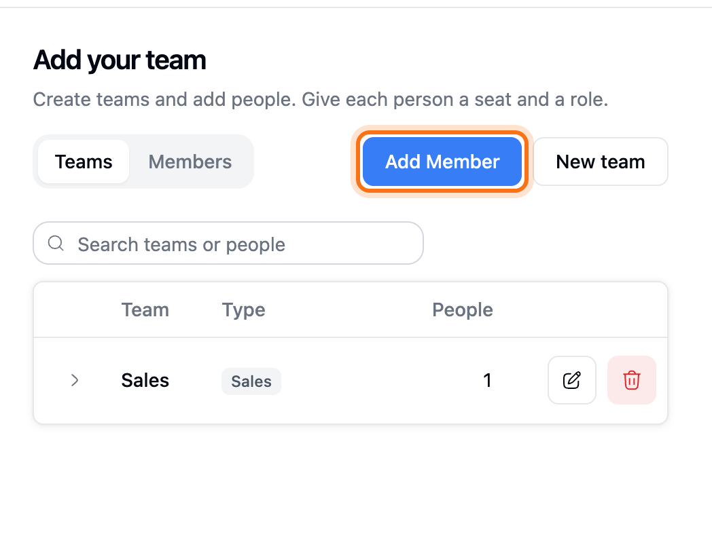

Use **Add Member** when someone does not have an Ergo account yet. For someone who has one, see [Add, remove or move members](https://support.joinergo.com/articles/2381379700) and [Change a role or seat type](https://support.joinergo.com/articles/9544077862).

## Who can use this

- The organization **Owner**, for any team.
- A team **Admin**, for the teams that Admin manages.
- A **Member** can open **Settings** → **Members**, but the page is read-only and has no **Add Member** button.

## Steps

1. Open **Settings** → **Members**.
2. Click **Add Member**.
3. Enter the person's **Work email**, **First name**, and **Last name**.
4. Choose the **Team**.
5. Choose the **Role in team**: **Member** (default) or **Admin**.
6. Choose the **Seat**: **Standard** (default), **Notetaker**, or **Spectator**. See [Seat types: what each seat can do](https://support.joinergo.com/articles/1478941509) first. Seats are billable.
7. Click **Add person**.

## What to expect

- Ergo creates the account at once and sends a welcome email.
- The email has a button (**Log In & Complete Onboarding** or **Log In to Dashboard**) that opens `dashboard.joinergo.com`. It has no single-use invite link and no code.
- The person signs in with that email, with the sign-in method of your organization. If the email does not arrive, the person can still sign in.
- A person with a Standard seat opens **Settings** → **User integrations** and connects **Email & calendar**, **Slack**, and a note taker.
- The CRM is one connection for the organization. An Owner or a team Admin connects it in **Settings** → **Org integrations** → **CRM**.
- The **Tasks** page shows for a Standard seat only if Tasks is on for your organization.

## Common issues

- **The email already exists.** An email can belong to one Ergo account in one organization. For a person who you removed before, the dialog says that Ergo notified the support team. Contact Ergo support. Do not make a second account.
- **The person cannot find Chat, Drafts or Automations.** The person is on a Notetaker or Spectator seat. Only the Owner can change the seat.
- **A team Admin cannot pick a team.** A team Admin can add people only to the teams that Admin manages.
- **Nothing is recording.** The person must connect the calendar in **Email & calendar**. Then the person must click **Connect** on **Ergo Notetaker** in **Note takers**.

## Related articles

- [Seats, roles and visibility](https://support.joinergo.com/articles/6821509431)
- [Seat types: what each seat can do](https://support.joinergo.com/articles/1478941509)
- [Add, remove or move members](https://support.joinergo.com/articles/2381379700)
- [Create/edit/delete teams](https://support.joinergo.com/articles/7682487269)
- [Notetaker setup](https://support.joinergo.com/articles/1280940465)
