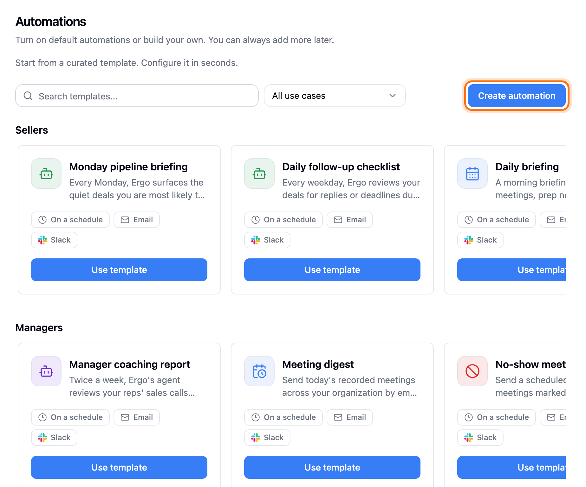

An automation does a task for you when something happens: on a schedule, after a meeting, after a CRM change, or after a different automation. It sends the result to Slack or email.

## Who can use this

- People with a **Standard** seat. Click **Automations** in the left navigation.

## The three tabs

- **Gallery:** templates for **Sellers**, **Managers** and **RevOps**. Click **Use template** on a template, or **Create automation** to start with an empty automation. The template list can be different for each organization.
- **My automations:** the automations that you can see. Each row has a switch to pause or activate the automation, and the badges **Active**, **Paused** or **Draft**.
- **Run History:** each run, with its status: **Queued**, **Running**, **Completed**, **Failed**, **No action needed**, **Canceled** or **Scheduled**. Click a run to see what it did and what it delivered.

## Build an automation

The builder has four sections:

1. **When:** **On a schedule**, **CRM record activity**, **Meeting activity** or **Automation completed**.
2. **What:** **Agent task** (Ergo follows your prompt) or **Static message** (fixed text with variables).
3. **Where:** **Slack message** or **Send email**. One automation has one destination.
4. **Who can manage this:** **Only me**, **A team** or **Entire organization**.

Click **Create automation** to start it at once, or **Save as draft**. Step-by-step: [Create a scheduled automation](https://support.joinergo.com/articles/5716109397).

## Test and run

- **Run sandbox** shows what the automation would send. It sends nothing and changes no CRM records.
- **Run live now** is a real run. It works only for an **Active** automation.
- Both buttons show only for scheduled automations.

## Limits and permissions

- Agent automations share one pool for the organization: the number of active Standard seats, to a maximum of 20. **Active**, **Paused** and **Draft** automations count. Daily briefings and **Static message** automations do not count.
- Everyone can make automations for **Only me**. A team **Admin** can also make them for **A team** (their own teams) or the **Entire organization**. The Owner can make all of them.
- Only the person who made an **Only me** automation can change it.

## Common issues

- **Create automation** is off: a necessary field is empty. Read **What will run** in the **Summary** panel.
- Slack delivery fails: connect the Slack workspace in **Settings → Org integrations**, and add Ergo to a private channel.
- **Organization agent automation limit reached**: pause or delete an agent automation.

## Related articles

- [Create a scheduled automation](https://support.joinergo.com/articles/5716109397)
- [Automation run history](https://support.joinergo.com/articles/5544381912)
- [Push notes or meetings to automations](https://support.joinergo.com/articles/9743385583)
