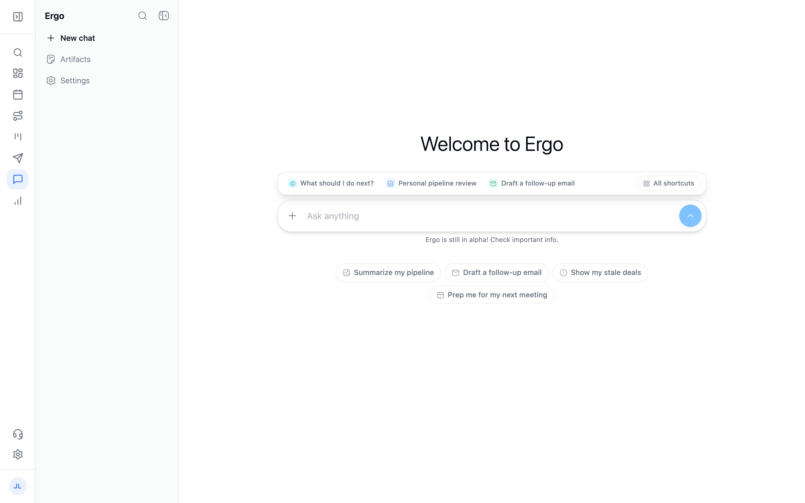

Sources show where an answer came from. Action cards are changes that Ergo proposes. Check both before you go on.

## Who can use this

- Anyone who uses **Chat with Ergo** or the **Ask Ergo** panel.

## Before you start

- Know which source type you expect: **Meeting**, **Email**, **Deal**, **Company**, **Slack**, **Knowledge Base** (a document) or **Web**.
- Make sure that you may see that source.
- Decide if you need an answer only, or also a change.

## Steps

1. Read the answer.
2. Put the pointer on a small number after a sentence. The card shows the type of the source, its title, its date and the text that Ergo read.
3. Click the number to open the record. To see all sources, click **sources** below the answer.
4. If there is a card with **Waiting for you**, read each proposed change. You can change a value on the card.
5. Click **Approve** to apply the change. Click **Reject** to cancel it.
6. Read the label on the card. **Approved** or **Applied** means done. **Rejected** or **Dismissed** means not done. **Failed** means try again.

## What to expect

- Ergo does not change your CRM or calendar before you approve.
- If you told Ergo in the chat to approve a type of change, the card shows **Auto-approved**.
- A source can be incomplete when a system is disconnected or still indexing.
- A source can be old. Use your own judgment.

## Common issues

- You treated a summary as proof. Open the source and check it.
- You assumed that a proposed change is done. Check the label on the card.
- A source is missing: the record is outside your access.
- The answer mixes sources of different age.

## Related articles

- [Chat with Ergo](https://support.joinergo.com/articles/2744746875)
- [Using deal and meeting context](https://support.joinergo.com/articles/5350733227)
- [Floating agent panel](https://support.joinergo.com/articles/1150437140)
- [Prompting Ergo and getting support](https://support.joinergo.com/articles/8587215553)
