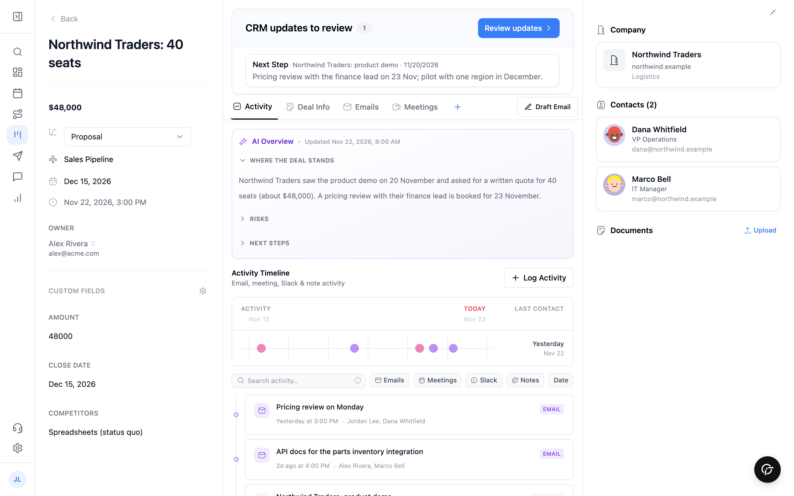

Use the deal and company pages to see the evidence behind a health score, an overview or a draft.

## Who can use this

- Everyone who can open **Deals**.
- You need a **Standard** seat and a HubSpot, Salesforce or Attio CRM to use **Log Activity**.

## Before you start

- Connect your CRM. If the page shows **No CRM Connected**, ask an owner or team admin to connect it in **Settings → Org integrations → CRM**.

## Steps

1. On a deal, use the tabs **Activity**, **Deal Info**, **Emails** and **Meetings**. On a company, use **Activity**, **Company Info**, **Emails** and **Meetings**.
2. In the **Activity Timeline**, use the chips **Emails**, **Meetings**, **Slack** and **Notes**, and the date filter.
3. Type in the search box to find an item.
4. To add your own notes to a meeting, open the meeting in the timeline. Click **Add your own notes**.
5. For a call that was recorded outside Ergo, open the deal. Click **Log Activity → Meeting**.
6. Fill in **Date**, **Title** and **Notes**. Click **Log Meeting**.
7. To log a note, click **Log Activity → Notes**. Fill in **Title** and **Note**.

## What to expect

- On a deal, the search box reads titles, people, notes, email text and meeting transcripts.
- On a company, the search matches email subjects only.
- **My notes** on a meeting has no title. It is the same note as on the Meetings page.
- You can open a note from **Log Activity** later and edit **Title** and **Note**.
- If you add an attendee email address in **Attendees**, Ergo also runs your CRM automation on the meeting, the same as for a recorded meeting.
- Activity can include emails, meetings and Slack when they are associated with the record.

## Common issues

- Activity is on the company, not the deal.
- A meeting or email exists but is not associated with the CRM record.
- **Log Activity** does not show: you do not have a **Standard** seat, or your CRM is not HubSpot, Salesforce or Attio.

## Related articles

- [Deal detail](https://support.joinergo.com/articles/3265804027)
- [Company detail](https://support.joinergo.com/articles/1988915841)
- [Manual notes](https://support.joinergo.com/articles/7787263112)
- [How Ergo names and matches CRM records](https://support.joinergo.com/articles/5841172398)
- [CRM sync issues](https://support.joinergo.com/articles/6503095041)
