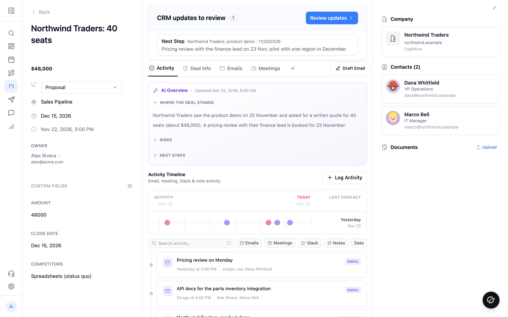

Ergo writes an overview of each deal and company. Use it to get oriented fast. Check the sources before you act.

## Who can use this

- Everyone who can open **Deals** can read an overview.
- You need a **Standard** seat for **Generate overview** and **Update overview**.
- An owner or team admin can change the overview template.

## Before you start

- Connect your CRM. See [Connect your CRM](https://support.joinergo.com/articles/2772377599).

## Steps

1. Open a deal or a company.
2. On the **Activity** tab, find the **AI Overview** card at the top. On a company, it is the **AI Account Overview** card.
3. If the card has no overview, click **Generate overview**.
4. If the card shows **Update overview**, click it. Ergo writes the overview again with the newest activity.
5. To change the template, click **Configure** on the card.
6. Edit the writing style and the sections. Click **Save draft** or **Publish**.

## What to expect

- The card shows when Ergo wrote the overview (**Updated** and the time).
- A warning icon means that Ergo has limited conversation data for the deal.
- **Publish** changes the overview of all deals (or all companies) in your organization.
- **Configure** shows only to owners and team admins with a **Standard** seat.
- An overview is only as good as the data that Ergo has. It can miss recent activity.

## Common issues

- The overview misses recent activity: click **Update overview**.
- The overview shows the company when you want the deal, or the reverse: open the right page.
- The sources are duplicated or do not match: see [How Ergo names and matches CRM records](https://support.joinergo.com/articles/5841172398).

## Related articles

- [Deal detail](https://support.joinergo.com/articles/3265804027)
- [Company detail](https://support.joinergo.com/articles/1988915841)
- [Deal and account health](https://support.joinergo.com/articles/6431504796)
- [Activity, emails, and meetings](https://support.joinergo.com/articles/2474119926)
