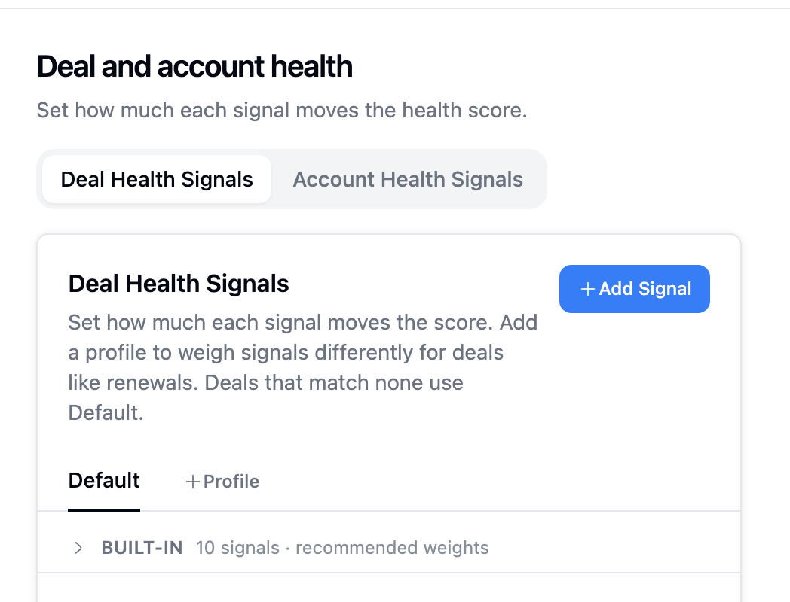

Use health to decide where to look next. It is not a forecast.

## Who can use this

- Everyone who can open **Deals** can read health.
- An owner or team admin sets how Ergo scores health.

## Before you start

- Connect your CRM. See [Connect your CRM](https://support.joinergo.com/articles/2772377599).

## Steps

1. Look at the health score on a deal card, or in the **Health** column of **List** view.
2. Open the deal. Read the **Deal Health** card with the signals and the trend chart.
3. Open a company. Read the **Account Health** card.
4. To change the scoring, open **Settings → Deal & Account Health**.
5. Select the tab **Deal Health Signals** or **Account Health Signals**.
6. Set each built-in signal to **Low**, **Medium** or **High**, or turn it off.
7. Click **Add Signal** to make a custom signal. Click **Profile** to add a scoring profile, for example for renewals.

## What to expect

- The score is 0 to 100. Below 40 is **At Risk**. 40 to 69 is **Needs Attention**. 70 or more is **Healthy**.
- A closed deal shows **Won** or **Lost**. A deal with no score shows **N/A**.
- Deal health is for open deals. Account health is for post-sale accounts. Ergo scores a company only after it has a closed-won deal.
- A profile has CRM conditions. Deals that match no profile use **Default**.
- You can add a maximum of 10 custom signals for deals and 10 for accounts. You can add a maximum of 10 profiles.
- Health does not change the CRM stage or the forecast category. The deal stage is one input of the deal score.

## Common issues

- The card shows **Not scored yet**: Ergo does not have sufficient data. For example, no emails, meetings or Slack conversations are linked to the deal.
- The score looks wrong: check that emails and meetings are associated with the right deal or company.
- Activity is on a related company, contact or deal.

## Related articles

- [Deal detail](https://support.joinergo.com/articles/3265804027)
- [Company detail](https://support.joinergo.com/articles/1988915841)
- [AI deal/account overviews](https://support.joinergo.com/articles/5742515808)
- [CRM sync issues](https://support.joinergo.com/articles/6503095041)
