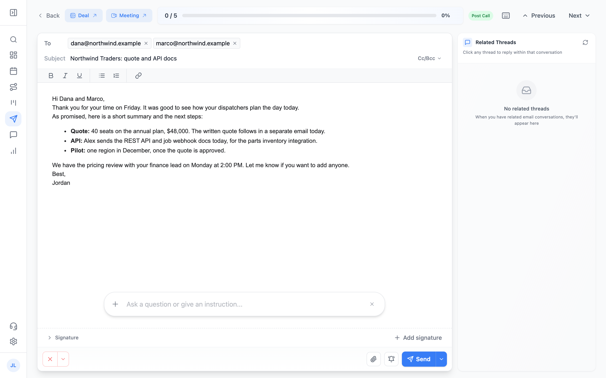

Check attachments, images and links before you send a draft. Check them as carefully as the recipients and the text.

## Who can use this

- People with a Standard seat who edit drafts.

## Before you start

- Make sure that the file is right to send outside your company.
- Make sure that your email account is connected.

## Steps

1. Open the draft.
2. Click **Attach files** (the paperclip button at the bottom of the draft). You can select 5 files at a time.
3. To add an image in the body, copy the image and paste it into the draft. The editor has no image button.
4. To add a link, select the text and click **Insert Link** in the toolbar (or press Cmd/Ctrl + K). Paste the address and press Enter.
5. Click a link in the body to edit or remove it.
6. Remove each attachment, image or link that does not belong in the email.

## What to expect

- One email can have 10 attachments and 25 MB in total (attachments and pasted images together).
- A pasted image must be JPEG, PNG, GIF or WebP, and 5 MB or less.
- Ergo does not attach program or script files (.exe, .bat, .cmd, .com, .pif, .scr, .vbs, .js, .jar, .app).
- Check each link by hand. A link from AI or from a template can be old.

## Common issues

- The file type is blocked. Use a different file type.
- The email is over 25 MB. Remove a file or use a link.
- A link points to an internal, expired or wrong page.
- You added an attachment to the wrong draft or thread.

## Related articles

- [Drafts inbox](https://support.joinergo.com/articles/5954330608)
- [Review/edit AI drafts](https://support.joinergo.com/articles/1674428019)
- [Email signatures and draft footers](https://support.joinergo.com/articles/9446610633)
- [Thread history and related threads](https://support.joinergo.com/articles/2828644087)
- [Failed drafts retry/report](https://support.joinergo.com/articles/2798745358)
