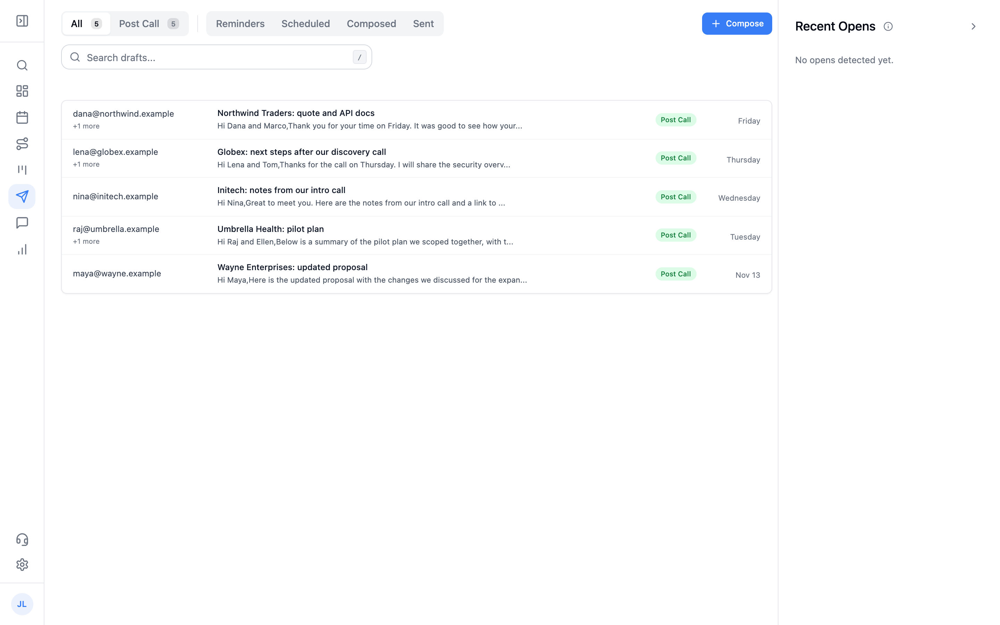

The **Drafts** page splits drafts into tabs by source and state. Use the tabs to work on the right drafts first.

## Who can use this

- People with a Standard seat.
- People who can use org-wide draft access, when Ergo support turns it on for the organization.

## Before you start

- Select **Drafts** in the left navigation.
- If you see the owner filter, check which person it shows.
- Some tabs show only when the feature is on for your organization.

## Tab meanings

- **All**: each draft that waits for review, from all sources. This tab opens first.
- **Post Call**: follow-up drafts that Ergo makes after meetings.
- **Surfacing**: proactive follow-up drafts. Shows only when the feature is on for your organization.
- **Quote Follow-ups**: follow-up emails with a published quote link, drafted after discovery calls. Shows only when quotes are on for your organization.
- **Account Handoffs**: handoff emails that Ergo drafts when deals reach key stages. Shows only when account handoffs are on for your organization.
- **Reminders**: drafts that you snoozed with a reminder date.
- **Scheduled**: drafts that wait to send at a later time.
- **Composed**: emails that you start with **Compose**, emails that you write with Ergo chat, reply drafts from the email inbox flow, and no-show and deal follow-up drafts.
- **Sent**: emails that Ergo sent.
- **Errors**: emails that did not send. The tab shows only when there is a failure. A failure stays in the list for 7 days.
- **Go Mode**: the drafts for the deals that you selected in **Deals → List**. While Go Mode is open, it is the only tab.
- A draft that an automation makes shows only on **All**.

## How to work through the tabs

1. Start with **All**, or with **Post Call**.
2. Use **Reminders** for drafts that you chose to do later.
3. Use **Scheduled** to check or cancel a future send.
4. Use **Sent** to check sent email.
5. Use **Errors** to read the message for each failure.

## What to expect

- Counts and tabs depend on the drafts for the selected person.
- Search filters the list. It does not change whether a draft exists.

## Common issues

- A tab is missing: the feature is off for your organization, or no draft is in that state.
- A manager sees fewer drafts than expected: the owner filter shows one person. Change it.
- A sent draft is not in a review tab: it moved to **Sent**.

## Related articles

- [Drafts inbox](https://support.joinergo.com/articles/5954330608)
- [Send/schedule/unschedule/undo](https://support.joinergo.com/articles/1895556641)
- [Open tracking and sent flow](https://support.joinergo.com/articles/2669378000)
- [Failed drafts retry/report](https://support.joinergo.com/articles/2798745358)
- [Go Mode](https://support.joinergo.com/articles/1983756142)
