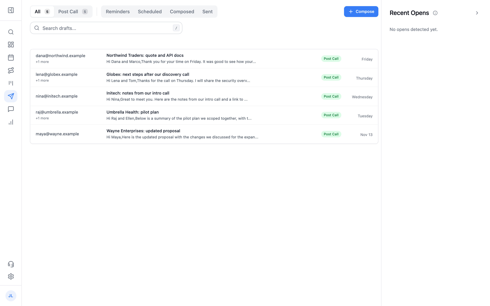

Use **Drafts** to review, edit, send and schedule the email drafts that Ergo makes. Each draft waits for you. Ergo does not send it until you do.

## Who can use this

- People with a Standard seat. **Drafts** is not in the left navigation for a Notetaker seat or a Spectator seat.
- All people in the organization, when org-wide draft access is on. Ergo support turns it on for an organization. There is no admin setting and no role rule for it.

## Before you start

- Connect your email account. See [Connect email and calendar](https://support.joinergo.com/articles/4928954637).
- For post-call drafts, open **Settings → Email Drafting → General**. Make sure **Post-call follow-up emails** is on. Each person sets this switch for their own account.

## Steps

1. Select **Drafts** in the left navigation.
2. Select a tab. **All** opens first and shows each draft that waits for review. The other tabs are **Post Call**, **Reminders**, **Scheduled**, **Composed** and **Sent**.
3. Type in the search box to narrow the list.
4. If your organization has org-wide draft access, use the owner filter next to the search box. Select **My Drafts**, **All Users**, or a person below **Team Members**.
5. Select a draft to open the editor.
6. Check the recipients, sender, subject, body, thread, attachments and signature.

## What to expect

- Selecting a draft only opens it. It does not send the email.
- **Errors** shows only when an email did not send.
- **Surfacing**, **Quote Follow-ups** and **Account Handoffs** show only when the feature is on for your organization.
- Sent and scheduled drafts move out of the review tabs.
- Ergo removes a draft that you do not send: after 7 days for most drafts, after 5 days for inbox reply drafts, and after 3 days for drafts from an automation.

## Common issues

- A draft is missing: the meeting did not qualify, or **Post-call follow-up emails** is off.
- A draft is missing in an org-wide view: check the owner filter. Select **All Users**.
- A draft does not send: open the **Errors** tab and read the message.

## Related articles

- [Draft tabs and queues](https://support.joinergo.com/articles/2725612744)
- [Review/edit AI drafts](https://support.joinergo.com/articles/1674428019)
- [Team access to email drafts](https://support.joinergo.com/articles/7232940075)
- [Failed drafts retry/report](https://support.joinergo.com/articles/2798745358)
- [Why some meetings do not generate insights or drafts](https://support.joinergo.com/articles/1207359797)
