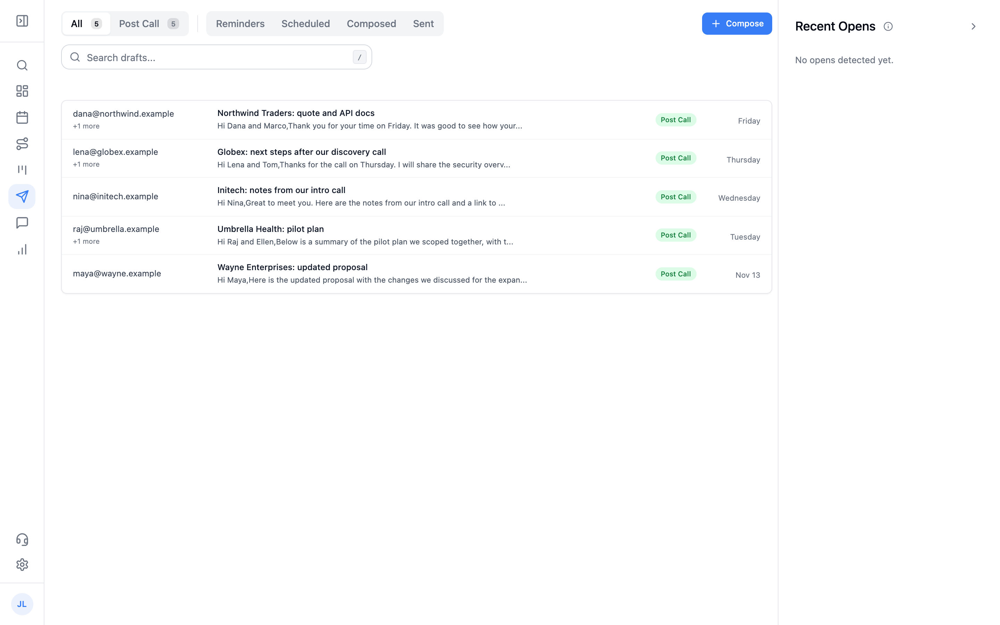

The **Errors** tab lists emails that did not send. A failure stays in the list for 7 days.

## Symptoms

- A message shows **N emails failed to send** with the link **Review & retry**.
- **Drafts** in the left navigation has a red mark.
- The **Errors** tab shows in **Drafts**. It shows only when an email did not send.

## Who can use this

- People with a Standard seat who send email from Ergo.

## Causes and fixes

1. Select the **Errors** tab. Or click **Review & retry**.
2. Read the reason in red on the row. Examples are **Email account connection expired** and **One or more recipients have invalid email addresses**.
3. Click the row to open the email. Correct the recipients, the subject or the body.
4. If the email connection is the cause, click **Fix** on the row. In **Settings → User integrations → Email & calendar**, click **Reconnect**.
5. Go back to **Errors** and click **Retry**.
6. If a corrected email fails again, click **Report**. The Ergo team gets the failed email. The button changes to **Reported**.
7. To remove a failure from the list, click **Clear**.

## What to expect

- Ergo tries a failed send again by itself before it shows the failure.
- **Retry** sends the same email again. It does not write the draft again.
- Before it sends, Ergo makes sure that the email has a sender, one or more recipients, a subject (for a new email) and a body.
- **Fix** shows only for an email connection failure.

## Common issues

- The email is larger than 25 MB. Remove or compress attachments.
- A recipient address is not valid. Correct it.
- The email connection is expired. Reconnect it, then retry.
- The send fails again after you correct the email. Click **Report**.

## Related articles

- [Drafts inbox](https://support.joinergo.com/articles/5954330608)
- [Send/schedule/unschedule/undo](https://support.joinergo.com/articles/1895556641)
- [Attachments, images, and links](https://support.joinergo.com/articles/4614702823)
- [Google/Microsoft/Slack reconnects](https://support.joinergo.com/articles/5648164253)
- [Get support](https://support.joinergo.com/articles/2708243049)
