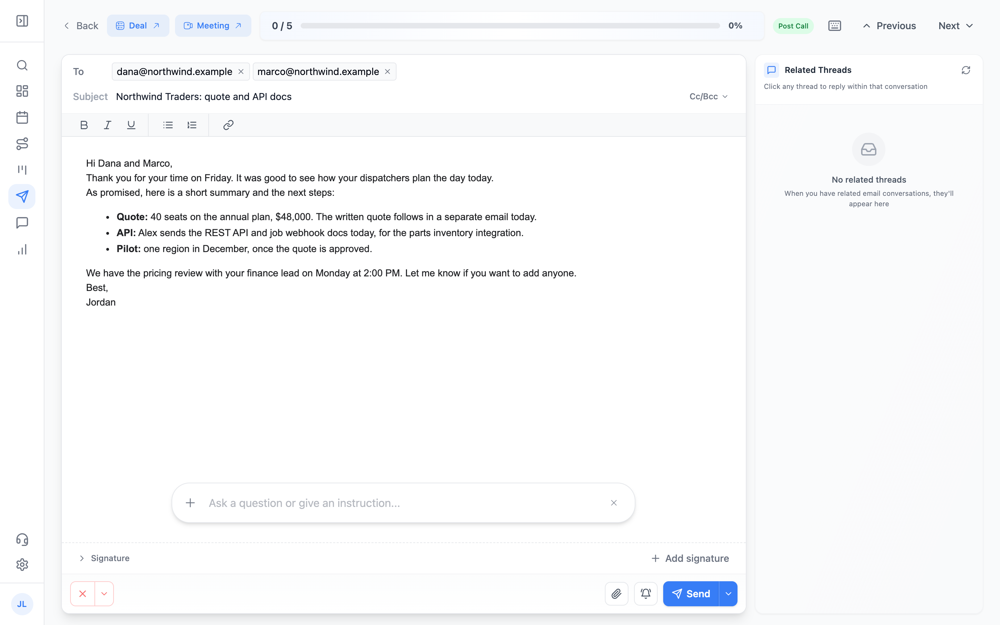

Use the **Email Assistant** to change a draft. Type an instruction, such as "make it shorter" or "add a bullet list".

## Who can use this

- People with a Standard seat who review AI drafts or composed drafts.

## Before you start

- Know the change that you want.
- Check the meeting, deal or thread, if your request depends on facts from them.

## Steps

1. Open the draft.
2. Find the **Email Assistant** box at the bottom of the draft. Its text is "Ask a question or give an instruction...".
3. Type a specific instruction and send it. To change only one part, select that text in the draft and click **Add to chat** first.
4. Review the new text. If it is not correct, point at your earlier message in the assistant and click **Restore** to go back to that version.
5. Make final edits by hand. Then send or schedule the email.

## What to expect

- The assistant changes the draft. It does not send the email.
- Specific instructions work better than broad ones.
- Read the full body again after each change.
- The assistant can miss context or add wording that the facts do not support.

## Common issues

- The prompt asks for information that is not in the meeting, thread, CRM or your instruction.
- The instruction is too broad and changes more than you want.
- A later AI change overwrites a manual edit. Use **Restore** to go back.
- The draft still needs a check of the recipients, thread, signature and attachments.

## Related articles

- [Drafts inbox](https://support.joinergo.com/articles/5954330608)
- [Review/edit AI drafts](https://support.joinergo.com/articles/1674428019)
- [Thread history and related threads](https://support.joinergo.com/articles/2828644087)
- [Prompting Ergo and getting support](https://support.joinergo.com/articles/8587215553)
- [Failed drafts retry/report](https://support.joinergo.com/articles/2798745358)
