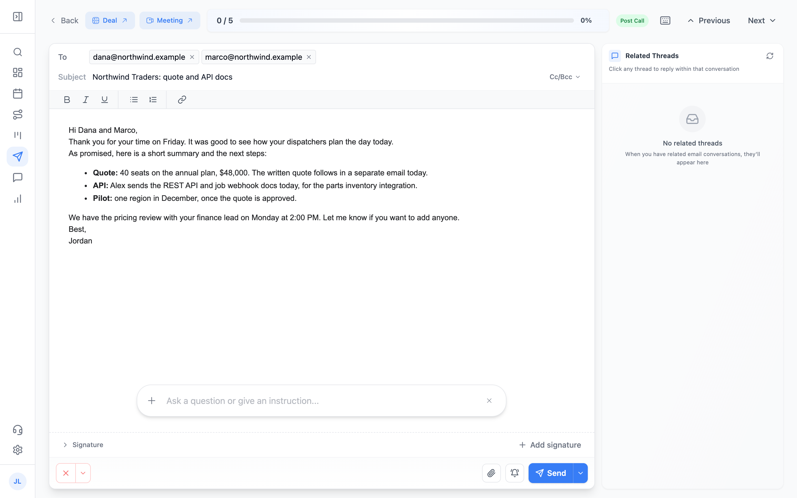

Send or schedule a draft only when it is ready for the recipient. You have 10 seconds to undo.

## Who can use this

- People with a Standard seat who send email from Ergo.

## Before you start

- Review the body and the recipients.
- Make sure that your email account is connected.

## Steps

1. Open the draft.
2. To send now, click **Send** (or press Cmd/Ctrl + Enter). There is no confirm step.
3. To schedule, click the arrow next to **Send** (or press **S**). Type or select a time in the **Schedule send...** box. The time must be from 2 minutes to 30 days from now.
4. To cancel a scheduled email, open the **Scheduled** tab and click **Unschedule** on the row. Or open the email and click **Unschedule**.
5. To send a scheduled email at once, open it and click **Send Now**.
6. To cancel an action, click **Undo** in the message.

## What to expect

- Ergo holds each action for 10 seconds. After you send, schedule, discard, set a reminder or disqualify, a message with **Undo** shows for 10 seconds.
- Ergo sends through your connected email account.
- A scheduled email stays in the **Scheduled** tab until it is sent or unscheduled.
- An unscheduled email returns to an editable draft.

## Common issues

- Email access is expired. Reconnect it, then try again.
- A required field is missing, such as **To**, **Subject** or the body.
- The scheduled time is too close, too far, or already past.
- A send fails: open the **Errors** tab and read the message.

## Related articles

- [Drafts inbox](https://support.joinergo.com/articles/5954330608)
- [Review/edit AI drafts](https://support.joinergo.com/articles/1674428019)
- [Open tracking and sent flow](https://support.joinergo.com/articles/2669378000)
- [Failed drafts retry/report](https://support.joinergo.com/articles/2798745358)
- [Google/Microsoft/Slack reconnects](https://support.joinergo.com/articles/5648164253)
