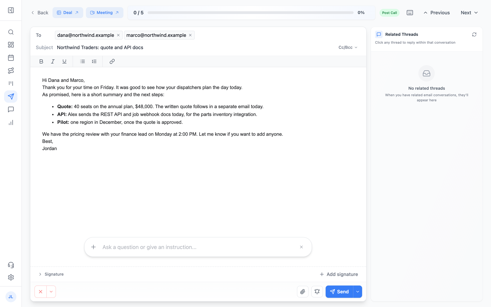

Use thread controls to make sure that a draft replies in the right conversation, or starts a new one.

## Who can use this

- People with a Standard seat who review drafts.

## Before you start

- Connect your email account.
- Check that the **To** field is correct.
- Read the existing conversation before you change the thread.

## Steps

1. Open the draft.
2. When the draft is a reply, the messages of the thread show above and below the reply box. Click a message to open it.
3. Look at **Related Threads** on the right of the draft. It lists email threads with the people in **To**.
4. Use **Search by email subject...** to find a thread.
5. To reply in a thread, click the thread in **Related Threads**. The draft becomes a reply in that thread.
6. To send a new email, click **Exit Thread** on the selected thread.

## What to expect

- Related threads are suggestions. Read the thread before you select it.
- The panel does not show for a scheduled email.
- A draft that you create as a new email has no thread.

## Common issues

- Thread history does not load: the email connection is expired or missing. Reconnect it.
- The selected thread has the right person but the wrong topic. Click **Exit Thread** and choose another thread.
- Related threads are incomplete: the connected account cannot see the full conversation.

## Related articles

- [Drafts inbox](https://support.joinergo.com/articles/5954330608)
- [Review/edit AI drafts](https://support.joinergo.com/articles/1674428019)
- [Compose a new email](https://support.joinergo.com/articles/7694737811)
- [Search in Ergo](https://support.joinergo.com/articles/4802879242)
- [Google/Microsoft/Slack reconnects](https://support.joinergo.com/articles/5648164253)
