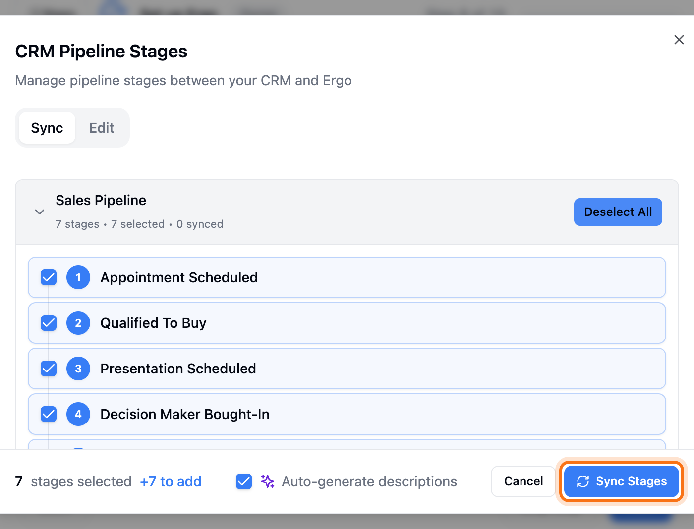

Ergo needs to know which stages belong to which pipeline. You set this on **CRM Stages**.

## Who can use this

- The organization **Owner** and team **Admins**.
- The setup is for one team. Select the team at the top right of the page.

## Before you start

- Connect your CRM. See [Connect your CRM](https://support.joinergo.com/articles/2772377599).

## Steps

1. Open **Settings → CRM Stages**. Select the team.
2. Click **Sync From CRM**. The window **CRM Pipeline Stages** shows each pipeline of your CRM.
3. Select the stages that the team uses. **Select All** selects all the stages of one pipeline.
4. Keep **Auto-generate descriptions** selected. Click **Sync Stages**.
5. Click **Stage Settings**. Turn on **Entry Point** for the stage where a new deal starts in each pipeline. Click **Save Changes**.
6. Select a pipeline in **Pipeline**. Click the pencil (**Edit Pipeline**) and write what the pipeline is for.
7. To remove a pipeline from the team, click the trash icon (**Delete Pipeline**) next to **Pipeline**.

## What to expect

- You select stages, not pipelines. A pipeline shows in the **Pipeline** selector after one of its stages is synced.
- Ergo cannot create a deal in a pipeline that has no entry point.
- The pipeline name and the stage order come from your CRM. Ergo uses the text from **Edit Pipeline** when it selects a pipeline for a new deal.
- With HubSpot or Attio, the window has the tab **Edit**. Changes there go directly to your CRM. With HubSpot you can add or rename a pipeline, and add, rename, reorder or delete a stage. With Attio you can add, rename or delete a stage.
- With Salesforce there is no tab **Edit**. Change the stages in Salesforce.
- **Delete Pipeline** clears the stages of the team for that pipeline. Your CRM and the other teams do not change.
- A sync only adds stages.

## Common issues

- A stage is missing: it is not selected in **Sync From CRM**.
- A stage row shows **Resolve Conflict**: the stage has a new name in the CRM. See [Stage drift conflicts](https://support.joinergo.com/articles/1509454679).
- A stage shows **Not in CRM**: the stage is no longer in your CRM.

## Related articles

- [Pipeline stages](https://support.joinergo.com/articles/1501601101)
- [Stage definitions and AI descriptions](https://support.joinergo.com/articles/7126058981)
- [Default stages](https://support.joinergo.com/articles/2392883371)
- [Stage drift conflicts](https://support.joinergo.com/articles/1509454679)
- [CRM sync issues](https://support.joinergo.com/articles/6503095041)
