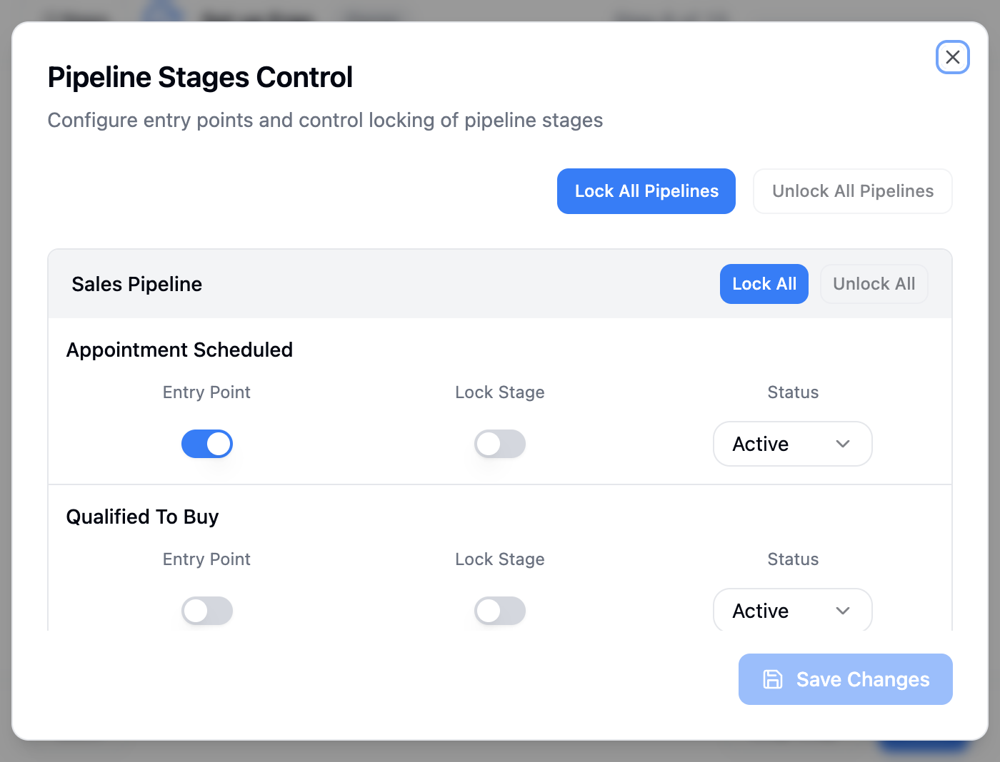

Stage controls set how Ergo uses each stage. You set them for each team.

## Who can use this

- The organization **Owner** and team **Admins**.
- No setting gives this right to other people. A team Admin sees only the teams that the Admin manages.

## Before you start

- Sync your stages. See [Pipeline stages](https://support.joinergo.com/articles/1501601101).

## Steps

1. Open **Settings → CRM Stages**. Select the team in the team selector at the top right.
2. Click **Stage Settings**. The window **Pipeline Stages Control** opens.
3. Turn on **Entry Point** for the stage where a new deal starts. Each pipeline needs one.
4. Turn on **Lock Stage** for a stage that Ergo must not move deals out of.
5. Set the **Status** of each stage: **Active**, **Won**, **Lost** or **Inactive**. Click **Save Changes**.
6. Open a stage row. Set its **Exit Points**: the stages that a deal can go to next.
7. To make Ergo ask before each stage move, click **⋯**. Turn on **Require approval before moving deals**.

## What to expect

- A stage that you sync starts as **Active**, with **Entry Point** off and **Lock Stage** off.
- Its **Exit Points** are all the later synced stages of the pipeline. Remove the ones that a deal must not go to.
- **Save Changes** is not available while a pipeline with unlocked synced stages has no entry point.
- With **Require approval before moving deals**, Ergo proposes each stage move. It waits for the deal owner to approve it.

## Common issues

- Ergo does not create deals: a pipeline has no **Entry Point**.
- Ergo does not move a deal out of a stage: the stage has **Lock Stage** on, or the next stage is not in **Exit Points**.
- The CRM rejects a stage change: check the rules in your CRM.

## Related articles

- [Pipeline stages](https://support.joinergo.com/articles/1501601101)
- [Restrict to pipeline](https://support.joinergo.com/articles/8307060346)
- [Stage drift conflicts](https://support.joinergo.com/articles/1509454679)
- [CRM sync issues](https://support.joinergo.com/articles/6503095041)
