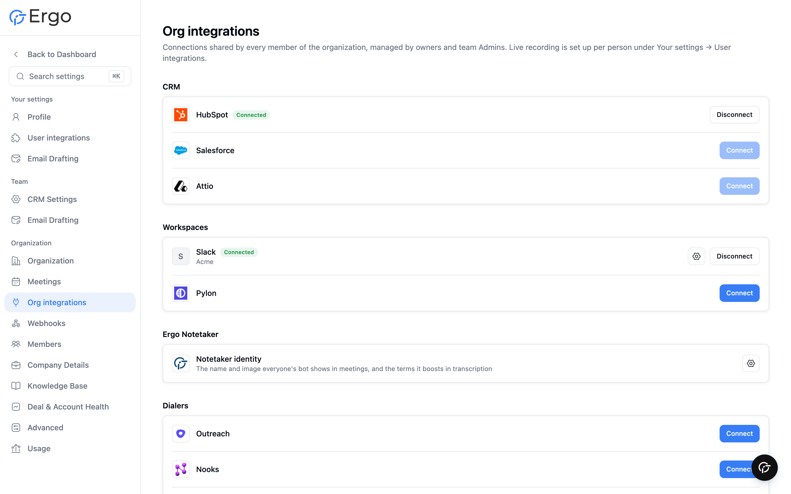

Connect Attio as your CRM for deals, companies and people. Ergo reads sales calls and email activity. It updates mapped Attio records, saves notes and writes follow-up drafts in Ergo.

## Who can use this

- The organization **Owner** and team **Admins**.
- Only these roles see **Org integrations** and can connect or disconnect the CRM.

## Before you start

- Use an Attio account that can approve the integration and can access the workspace records that Ergo must use.
- An organization can have only one CRM connected. If the **Connect** button is off, a different CRM is connected. Disconnect it first.

## Steps

1. Open **Settings → Org integrations**.
2. In the **CRM** section, click **Connect** in the **Attio** row.
3. Approve access to the correct Attio workspace.
4. Return to **Org integrations**. Make sure that the **Attio** row shows **Connected**.
5. Open **Settings → CRM Properties** and **Settings → CRM Stages**. Sync the attributes and deal stages that Ergo must use.
6. In **CRM Properties**, open each property. Set **Write behavior** to choose if Ergo can write to the attribute.
7. Where the option shows, select **Require approval before writing** if a person must approve each value.

## What to expect

- Ergo reads existing Attio records to find the right people, companies and deals.
- Ergo can create or update records and fill attributes, based on your mapping and settings. An update that needs approval waits for review.
- Ergo saves meeting summaries, logged emails and configured Slack activity as Notes on the Attio deal. Ergo does not write them as native Attio meeting records.
- Ergo can read tasks that are linked to a deal. Ergo does not create, change or delete Attio tasks.
- Ergo works with the people, companies and deals objects. It does not use Attio lists.
- Ergo uses the call context to write follow-up drafts in Ergo.

## Common issues

- Connection or access errors: check that the connection is active and that you granted the access that Attio asked for.
- An attribute or deal stage changed after setup: review your mapping in **CRM Properties** and **CRM Stages**.
- An update did not appear: check the mapping, the **Write behavior**, and whether the update needs approval. See [CRM sync issues](https://support.joinergo.com/articles/6503095041).

## Related articles

- [Connect your CRM](https://support.joinergo.com/articles/2772377599)
- [Salesforce](https://support.joinergo.com/articles/2093487681)
- [HubSpot](https://support.joinergo.com/articles/7579052434)
- [CRM properties setup](https://support.joinergo.com/articles/3371162277)
- [Permission or access denied](https://support.joinergo.com/articles/4190135592)
