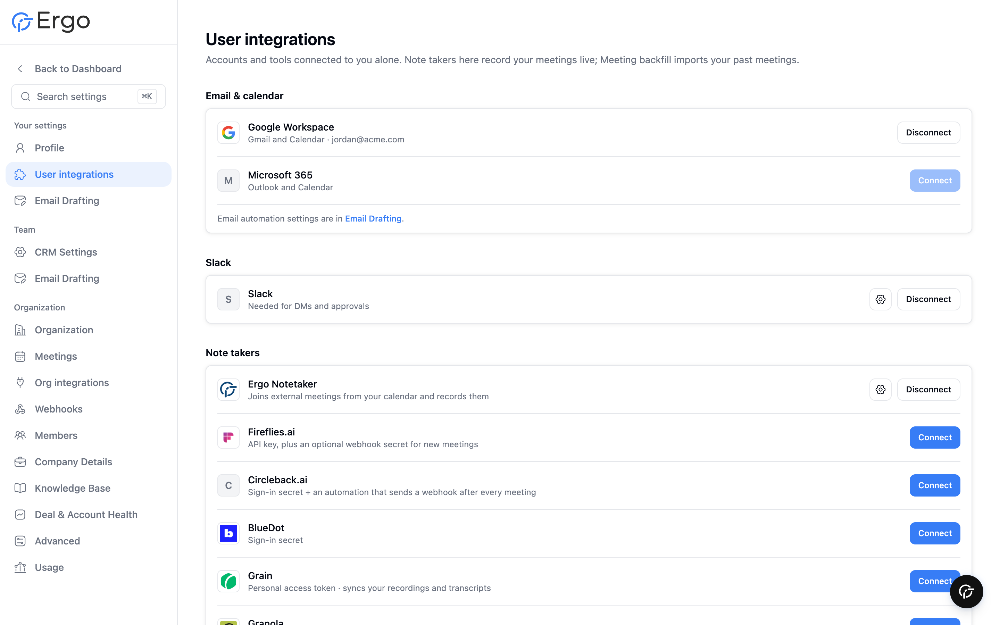

Connect BlueDot when it is one of your meeting recording sources. You add an Ergo webhook URL in BlueDot.

## Who can use this

- People with a **Standard** seat. Each person connects their own account.
- This is a personal connection. It is not an organization connection.

## Before you start

- Have your BlueDot sign-in secret ready.
- One person can connect only one of these notetakers: Gong, Fireflies, Circleback, BlueDot, Fathom, Grain. None of them works together with Ergo Notetaker, Ergo Desktop Notetaker or Granola. Ergo shows **Disconnect {name} first**.

## Steps

1. Open **Settings → User integrations**. In **Note takers**, find **BlueDot** and click **Connect**.
2. In the **Connect to BlueDot** window, click **Copy** next to **Webhook URL**.
3. In BlueDot, add this URL as the webhook for your recorded meetings.
4. In Ergo, paste your secret in **BlueDot sign-in secret**. Click **Connect**.
5. Make sure that the **BlueDot** row shows **Disconnect** in place of **Connect**.
6. Record one test meeting. Look for it in **Meetings**.

## What to expect

- A connected row has no **Connected** label. The button changes to **Disconnect**.
- If BlueDot sends no attendees, transcript or summary, the output in Ergo can be less complete.

## Common issues

- **Disconnect {name} first** shows: another notetaker is connected. Disconnect it first.
- Meetings do not arrive: the webhook URL or the sign-in secret is wrong.
- Two sources recorded one meeting: see [Using multiple notetakers with Ergo](https://support.joinergo.com/articles/3534048190).
- A meeting is not processed: see [Meeting processing time and status states](https://support.joinergo.com/articles/3507520478).

## Related articles

- [Using multiple notetakers with Ergo](https://support.joinergo.com/articles/3534048190)
- [Meeting processing time and status states](https://support.joinergo.com/articles/3507520478)
- [Notetaker setup](https://support.joinergo.com/articles/1280940465)
- [Circleback](https://support.joinergo.com/articles/8797191184)
