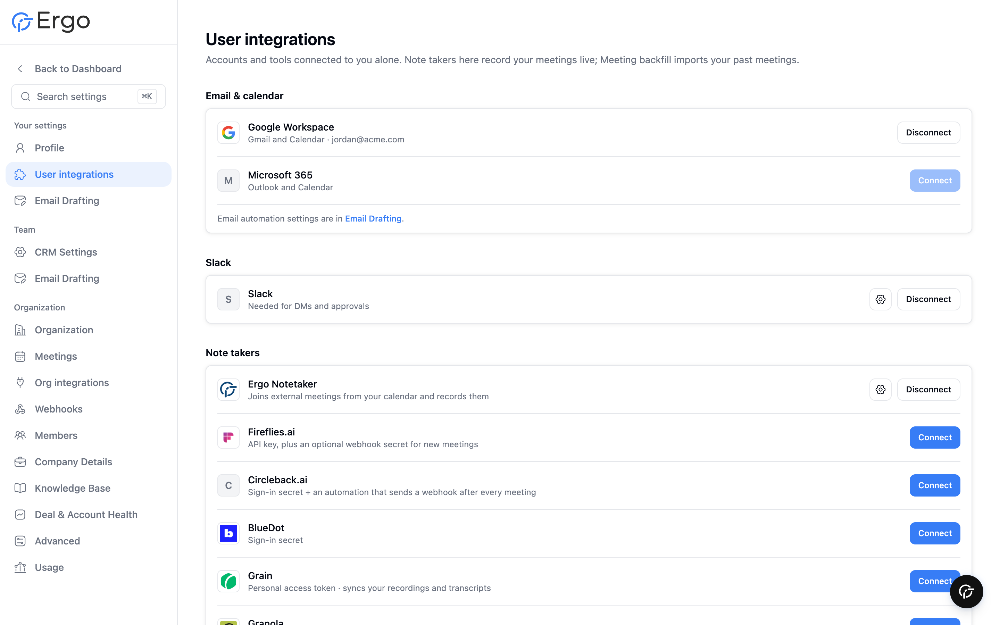

Connect Circleback when it is one of your meeting note sources. You make an automation in Circleback that sends each meeting to Ergo.

## Who can use this

- People with a **Standard** seat. Each person connects their own account.
- This is a personal connection. It is not an organization connection.

## Before you start

- Have access to Circleback automations.
- Get your sign-in secret from Circleback.
- One person can connect only one of these notetakers: Gong, Fireflies, Circleback, BlueDot, Fathom, Grain. None of them works together with Ergo Notetaker, Ergo Desktop Notetaker or Granola. Ergo shows **Disconnect {name} first**.

## Steps

1. Open **Settings → User integrations**. In **Note takers**, find **Circleback.ai** and click **Connect**.
2. In the **Connect to Circleback.ai** window, click **Copy** next to **Webhook URL**.
3. In Circleback, open **Automations** and make an automation.
4. Set **When to run** to **After every meeting**.
5. Add the step **Send webhook request**. Paste the URL. Under **What to include**, select **Meeting Notes**, **Transcript** and **Action Items**.
6. Add the step **End Automation**. Name the automation and save it.
7. In Ergo, paste your secret in **Circleback sign-in secret**. Click **Connect**.
8. Make sure that the row shows **Disconnect**. Finish one test meeting and look for it in **Meetings**.

## What to expect

- Ergo gets a meeting only when the Circleback automation runs after the meeting.
- If Circleback has no transcript, notes or action items, the output in Ergo can be less complete.

## Common issues

- **Disconnect {name} first** shows: another notetaker is connected. Disconnect it first.
- Meetings do not arrive: the webhook URL was copied wrong, or the automation does not include notes, transcript and action items.
- Two sources recorded one meeting: see [Using multiple notetakers with Ergo](https://support.joinergo.com/articles/3534048190).
- A meeting is not processed: see [Meeting processing time and status states](https://support.joinergo.com/articles/3507520478).

## Related articles

- [Using multiple notetakers with Ergo](https://support.joinergo.com/articles/3534048190)
- [Meeting processing time and status states](https://support.joinergo.com/articles/3507520478)
- [Notetaker setup](https://support.joinergo.com/articles/1280940465)
- [BlueDot](https://support.joinergo.com/articles/5424968361)
