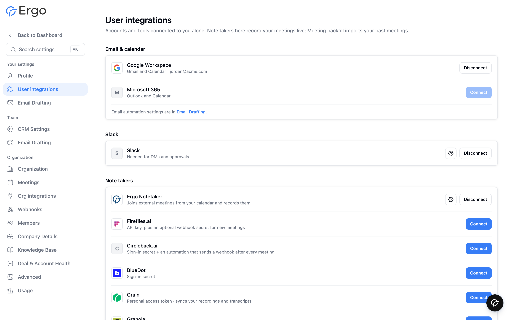

Connect Fireflies when it is one of your meeting recording sources.

## Who can use this

- People with a **Standard** seat. Each person connects their own account.
- This is a personal connection. It is not an organization connection.

## Before you start

- Have your Fireflies API key ready.
- To get new meetings automatically, also make a webhook in Fireflies. Have its secret ready. Without the webhook secret, Ergo imports only your past Fireflies meetings.
- One person can connect only one of these notetakers: Gong, Fireflies, Circleback, BlueDot, Fathom, Grain. None of them works together with Ergo Notetaker, Ergo Desktop Notetaker or Granola. Ergo shows **Disconnect {name} first**.

## Steps

1. Open **Settings → User integrations**. In **Note takers**, find **Fireflies.ai** and click **Connect**.
2. In Fireflies, find your API key in the developer settings and copy it.
3. In the **Connect to Fireflies.ai** window, paste the key in **API Key**.
4. Optional, for new meetings: click **Copy** next to **Webhook URL**. In Fireflies, make a webhook with this URL and the event **meeting.summarized**. Copy the webhook secret.
5. Paste the secret in **Webhook Secret Key (optional)**.
6. Click **Connect**. Ergo checks the API key with Fireflies before it saves it.
7. Make sure that the row shows **Disconnect**.
8. Finish one test meeting in Fireflies. Look for it in **Meetings**.

## What to expect

- Ergo imports a new meeting when Fireflies sends the **meeting.summarized** event.
- Webhooks for a whole team need the Fireflies Enterprise tier.
- Ergo gets the data only when Fireflies delivers it.

## Common issues

- The API key is not valid: copy it again from Fireflies.
- **Disconnect {name} first** shows: another notetaker is connected. Disconnect it first.
- New meetings do not arrive: the webhook or the secret is missing, or the event is not **meeting.summarized**.
- Two sources recorded one meeting: see [Using multiple notetakers with Ergo](https://support.joinergo.com/articles/3534048190).
- A meeting is not processed: see [Meeting processing time and status states](https://support.joinergo.com/articles/3507520478).

## Related articles

- [Using multiple notetakers with Ergo](https://support.joinergo.com/articles/3534048190)
- [Meeting processing time and status states](https://support.joinergo.com/articles/3507520478)
- [Notetaker setup](https://support.joinergo.com/articles/1280940465)
- [Permission or access denied](https://support.joinergo.com/articles/4190135592)
