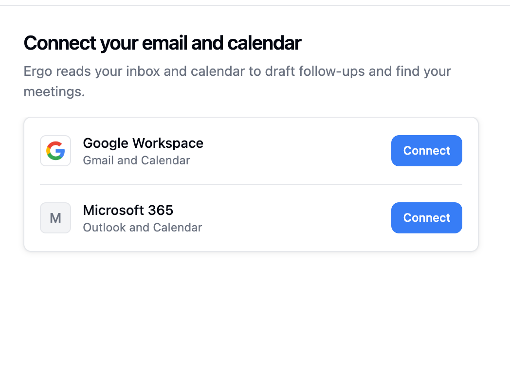

Connect your Google account so Ergo can use Gmail and Google Calendar for you.

## Who can use this

- Each person with a **Standard** or **Notetaker** seat connects their own account.
- A **Spectator** seat does not see the **Email & calendar** section.
- The email switches in **Email Drafting** need a **Standard** seat.

## Before you start

- Sign in with the Google account that has the same email address as your Ergo sign-in. Ergo refuses a different address with the message "Please connect using the same email address you use to sign in to Ergo."
- You can connect only one email provider. If Microsoft 365 is connected, disconnect it first. The **Connect** button of Google Workspace shows **Disconnect Microsoft first**.

## Steps

1. Open **Settings → User integrations**.
2. In the **Email & calendar** section, click **Connect** in the **Google Workspace** row.
3. Approve the Google access request.
4. Make sure that the message **Google Workspace connected** shows. The row shows your email address after **Gmail and Calendar**. The button changes to **Disconnect**.
5. Open **Settings → Email Drafting → General**.
6. Under **What Ergo does with your mailbox**, set the switches **Post-call follow-up emails**, **Email analysis**, **Email inbox flow (triage)** and **Draft replies to internal emails**.

## What to expect

- Ergo uses Gmail and Calendar for email analysis, follow-up drafts and upcoming meetings.
- The row has no **Connected** label. Look for your email address and **Disconnect**.
- The Google row has no settings. The note below the rows says that email settings are in **Email Drafting**.
- If the Google grant expires, Ergo shows the page **Reconnect Your Google Account** in place of the app. Click **Reconnect Google**. Ergo also sends an email with the button **Reconnect on Ergo**.

## Common issues

- The connection is refused: the Google address is not the same as your Ergo sign-in address.
- The **Connect** button is off: Microsoft 365 is connected. Disconnect it first.
- Calendar events are missing: the connected account cannot access that calendar.
- The app asks you to reconnect: see [Google/Microsoft/Slack reconnects](https://support.joinergo.com/articles/5648164253).
- Meetings do not join: see [Notetaker did not join](https://support.joinergo.com/articles/2299804002).

## Related articles

- [Connect email and calendar](https://support.joinergo.com/articles/4928954637)
- [Microsoft 365](https://support.joinergo.com/articles/9353990784)
- [Google/Microsoft/Slack reconnects](https://support.joinergo.com/articles/5648164253)
- [Turn post-call drafts on or off](https://support.joinergo.com/articles/3684399934)
- [Permission or access denied](https://support.joinergo.com/articles/4190135592)
