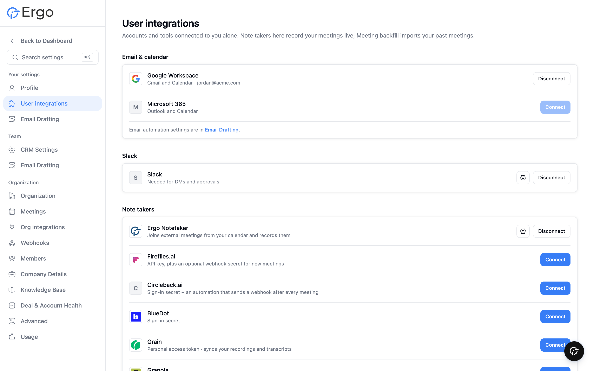

Connect Granola when it is one of your meeting note sources. You paste a personal API token from the Granola desktop app.

## Who can use this

- People with a **Standard** seat. Each person connects their own account.
- Ergo support must turn on Granola import for your organization first. Without it, Ergo saves your token but does not import your notes.

## Before you start

- Ask Ergo support to turn on Granola import for your organization.
- You need a Granola Business or Enterprise plan to make an API token.
- You cannot connect Granola while Gong, Fireflies, Circleback, BlueDot, Fathom or Grain is connected. You also cannot connect it while Ergo Notetaker or Ergo Desktop Notetaker is connected, unless Ergo support allowed this for your organization. Disconnect the other notetaker first.

## Steps

1. In the Granola desktop app, open **Settings → Connectors → API keys**. Make a personal API token.
2. In Ergo, open **Settings → User integrations**. In **Note takers**, find **Granola** and click **Connect**.
3. In the **Connect Granola via API token** window, paste the token in **Personal API token**. Click **Save token**.
4. Make sure that the **Granola** row shows **Disconnect**.
5. Write one new note in Granola. Then look for the meeting in **Meetings**.

## What to expect

- The connection brings in new notes.
- To bring in past notes, use **Meeting backfill → Granola historical import** on the same page. It has its own token window. It does not record or sync new meetings.
- The app has no preferred-source control. Only the API token can be connected.

## Common issues

- No notes arrive: Granola import is not turned on for your organization. Ask Ergo support.
- The connect is refused with "Another notetaker is already connected. Disconnect it first.": disconnect the other notetaker.
- The token is revoked or old: make a new token and click **Connect** again.
- A note is already imported or still waiting. See [Meeting processing time and status states](https://support.joinergo.com/articles/3507520478).
- Two sources recorded one meeting: see [Using multiple notetakers with Ergo](https://support.joinergo.com/articles/3534048190).

## Related articles

- [Using multiple notetakers with Ergo](https://support.joinergo.com/articles/3534048190)
- [Meeting processing time and status states](https://support.joinergo.com/articles/3507520478)
- [Notetaker setup](https://support.joinergo.com/articles/1280940465)
- [Fathom](https://support.joinergo.com/articles/4094195902)
