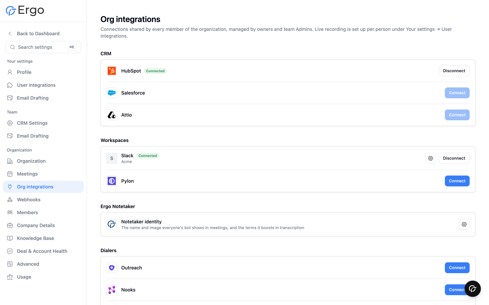

Connect HubSpot when it is your CRM source of truth for deals, companies and contacts.

## Who can use this

- The organization **Owner** and team **Admins**.
- Only these roles see **Org integrations** and can connect or disconnect the CRM.

## Before you start

- Use a HubSpot account that can access the objects and properties that Ergo must read or update.
- An organization can have only one CRM connected. If the **Connect** button is off, a different CRM is connected. Disconnect it first.

## Steps

1. Open **Settings → Org integrations**.
2. In the **CRM** section, click **Connect** in the **HubSpot** row.
3. Complete the HubSpot approval.
4. Return to **Org integrations**. Make sure that the **HubSpot** row shows **Connected**.
5. Open **Settings → CRM Properties** and **Settings → CRM Stages**. Sync the properties and stages that Ergo must use.
6. Open **Settings → CRM Settings**. Use **Permissions** to set what Ergo can create and update. Use **CRM behavior → CRM Logging** to set which email and Slack activities Ergo logs.
7. Test with a small number of meetings or deals.

## What to expect

- Ergo logs a meeting activity in HubSpot automatically after it processes an external sales meeting. There is no setting or workflow for this. See [HubSpot meeting activities and recording links](https://support.joinergo.com/articles/4867356454).
- HubSpot permissions and pipeline setup can change what Ergo can read or write.

## Common issues

- The account you approved cannot access an object or property: connect again with a different account.
- A property was renamed or removed after setup: sync the properties again.
- A meeting activity is not on the record. The meeting was internal, was not a sales meeting, or matched a different deal or company.
- Updates look wrong: see [CRM sync issues](https://support.joinergo.com/articles/6503095041).

## Related articles

- [Connect your CRM](https://support.joinergo.com/articles/2772377599)
- [Salesforce](https://support.joinergo.com/articles/2093487681)
- [HubSpot meeting activities and recording links](https://support.joinergo.com/articles/4867356454)
- [CRM properties setup](https://support.joinergo.com/articles/3371162277)
- [Pipeline stages](https://support.joinergo.com/articles/1501601101)
- [Permission or access denied](https://support.joinergo.com/articles/4190135592)
