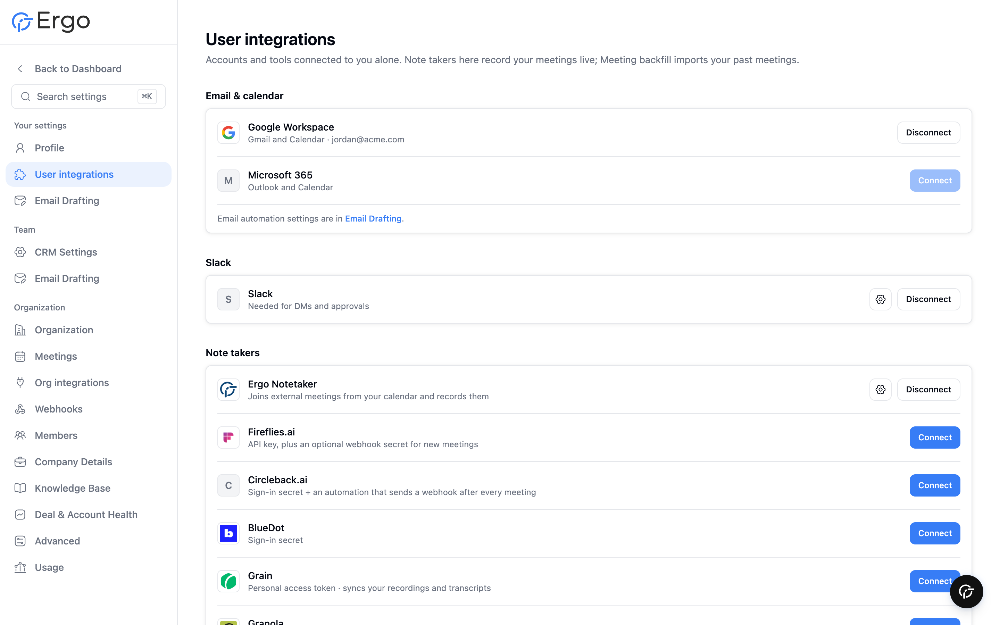

MCP lets an AI client ask Ergo questions and read meeting transcripts as you. There is no API key. You sign in with your Ergo account.



The Ergo MCP URL is `https://api.joinergo.com/api/mcp`.

## Who can use this

- Each person, for their own Ergo account. All seat types see the **MCP** section.
- **Standard** seat: `ask_ergo_agent`, `get_ergo_agent_result` and `query_meeting_transcripts`.
- **Notetaker** seat: `query_meeting_transcripts` and `search_data` (read-only CRM search).
- **Spectator** seat: `query_meeting_transcripts` only. Ask Ergo requests are rejected.

## Before you start

- Sign in to Ergo as the person whose data the client should use. The connection is that person in that organization. It is not an organization-wide key.
- Use a Standard seat if you need Ask Ergo.

## Steps

1. Open **Settings → User integrations**.
2. In the **MCP** section, find your client. Select **Setup steps**.
3. Copy the URL or the command from the dialog.
4. Add Ergo in your client with the steps below.
5. Sign in with your Ergo account when the browser opens.

### Claude Desktop / Claude.ai

On a Claude Team or Enterprise plan, a Claude owner must add Ergo first. The owner opens **Organization settings → Connectors → Add → Custom → Web** and pastes the URL. Then each person opens **Customize → Connectors**, selects **Connect** on Ergo and signs in.

On other plans, select **+**, then **Add custom connector**. Paste the URL and sign in.

### Claude Code

Run this command. Then open Claude Code, run `/mcp`, select Ergo and finish the sign-in.

```
claude mcp add --transport http --scope user ergo 'https://api.joinergo.com/api/mcp'
```

### Codex app

1. Open **Settings → MCP servers** and select **Add server**.
2. Name the server `ergo`, select **Streamable HTTP** and paste the URL.
3. Save the server, then select **Restart**.
4. Select **Authenticate** for Ergo and sign in.
5. Start a new task. Use `/mcp` to make sure that Ergo is connected.

### Codex CLI

Run the two commands. Finish the sign-in in the browser.

```
codex mcp add ergo --url 'https://api.joinergo.com/api/mcp'
codex mcp login ergo
```

### Grok

1. On Grok Business or Enterprise, ask a team admin to add Ergo first. At console.x.ai, select the team. Go to **Grok Business → Connectors → + Add Connector → Other** and add the URL.
2. Open grok.com/connectors. If your admin added Ergo, connect your own account. If not, select **New Connector**, then **Custom**.
3. Paste the URL and sign in with your Ergo account.

### Other MCP clients

Any client with remote HTTP MCP and OAuth can use the same URL.

## What to expect

- `ask_ergo_agent` returns at once with the status `queued`. It does not return the answer. Wait, then call `get_ergo_agent_result` with the `runId` until the status is `answered`, `blocked` or `error`. Keep the `threadId` to continue the conversation.
- `query_meeting_transcripts` finds meetings by title or by attendee name or email. It does not search words inside the transcript. Then it returns transcript pages for a `meetingId`.
- Transcript access follows the **Meetings** page rules.

## Common issues

- A `401` after idle time: sign in again in the client.
- A `403`: your user or organization is inactive.
- A `429`: you sent too many requests. Wait at least the time in the reply.
- When you report a failed request, include the `X-Request-ID` from the response.

## Related articles

- [Seat types: what each seat can do](https://support.joinergo.com/articles/1478941509)
- [Seats, roles and visibility](https://support.joinergo.com/articles/6821509431)
- [Meeting availability and visibility](https://support.joinergo.com/articles/9550556881)
- [Get support](https://support.joinergo.com/articles/2708243049)
