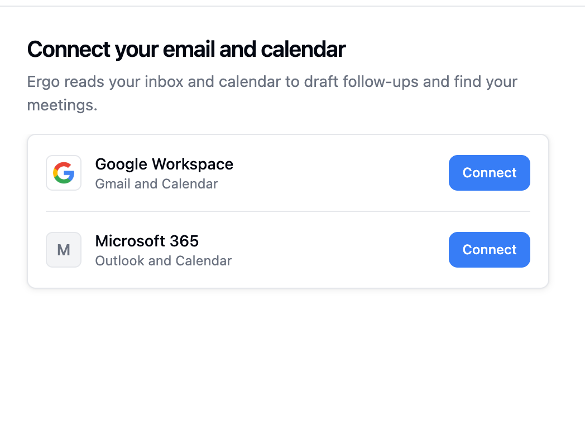

Connect your Microsoft account so Ergo can use Outlook and Calendar for you.

## Who can use this

- Each person with a **Standard** or **Notetaker** seat connects their own account.
- An Owner or Admin cannot connect the mailbox of another person.
- The email switches in **Email Drafting** need a **Standard** seat.

## Before you start

- Sign in with the Microsoft account that has the same email address as your Ergo sign-in. Ergo refuses a different address with the message "Please connect using the same email address you use to sign in to Ergo."
- You can connect only one email provider. If Google Workspace is connected, disconnect it first. The **Connect** button of Microsoft 365 shows **Disconnect Google first**.
- If your Microsoft tenant blocks new apps, ask your Microsoft admin to approve Ergo first.

## Steps

1. Open **Settings → User integrations**.
2. In the **Email & calendar** section, click **Connect** in the **Microsoft 365** row.
3. Approve the Microsoft access request.
4. Make sure that the message **Microsoft 365 connected** shows. The row shows your email address after **Outlook and Calendar**. The button changes to **Disconnect**.
5. Open **Settings → Email Drafting → General**.
6. Turn on the switches that your team uses: **Post-call follow-up emails**, **Email analysis** and **Email inbox flow (triage)**.
7. Test the email and calendar workflow.

## What to expect

- Ergo uses Outlook and Calendar for email analysis, drafts, meetings and upcoming meetings.
- The row has no **Connected** label. Look for your email address and **Disconnect**.
- The email switches are not on the Microsoft row. They are in **Email Drafting**.
- If the grant expires, Ergo asks you to connect again. See [Google/Microsoft/Slack reconnects](https://support.joinergo.com/articles/5648164253).

## Common issues

- The connection is refused with the same-address message: use the Microsoft account with your Ergo sign-in address.
- The **Connect** button is off: Google Workspace is connected. Disconnect it first.
- A tenant policy blocks the approval: ask your Microsoft admin.
- Calendar events are missing: the connected account cannot access that calendar.
- Meetings do not join: see [Notetaker did not join](https://support.joinergo.com/articles/2299804002).

## Related articles

- [Connect email and calendar](https://support.joinergo.com/articles/4928954637)
- [Google Workspace](https://support.joinergo.com/articles/9333675093)
- [Google/Microsoft/Slack reconnects](https://support.joinergo.com/articles/5648164253)
- [Turn post-call drafts on or off](https://support.joinergo.com/articles/3684399934)
- [Permission or access denied](https://support.joinergo.com/articles/4190135592)
