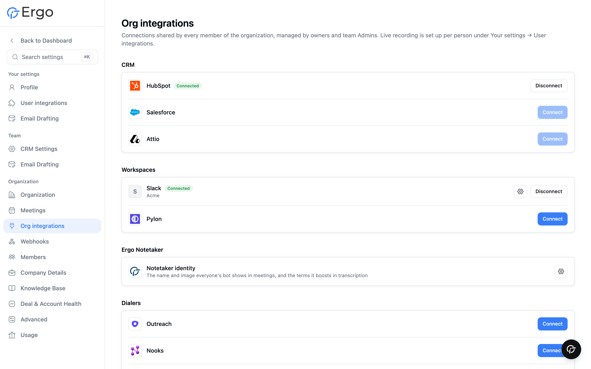

Connect Pylon when you want Ergo to send completed meetings to Pylon. Ergo sends them as call recording records.

## Who can use this

- The organization **Owner** or a team **Admin** can connect, update or disconnect Pylon.
- Only the **Owner** sees the gear icon for **Manage Pylon**.

## Before you start

- Have the Pylon API key that your team wants Ergo to use.
- Decide whose meetings go to Pylon.

## Steps

1. Open **Settings → Org integrations**.
2. In the **Workspaces** section, click **Connect** in the **Pylon** row.
3. In the **Connect Pylon** window, paste the key in **Pylon API key**. Click **Connect**.
4. Make sure that the **Pylon** row shows **Connected**.
5. Owner: click the gear in the **Pylon** row to open **Manage Pylon**. Select **Everyone** or **Specific people**.
6. Test with one completed meeting.

To replace the key later, click **Update** in the **Pylon** row. To remove the connection, click **Disconnect**.

## What to expect

- Ergo sends the title, the start and end time, the participants, the transcript and a link to the meeting in Ergo. Ergo does not send the audio or video file.
- Ergo sends a meeting only when processing is complete, the meeting has a transcript, and the meeting is not a no-show. The meeting must also be from a person in the **Manage Pylon** selection.
- This is not a general Pylon support-ticket sync.

## Common issues

- You cannot connect Pylon: you are not an **Owner** or a team **Admin**.
- A meeting is not in Pylon: it is not processed, has no transcript, was a no-show, or is not in the **Manage Pylon** selection. See [Meeting processing time and status states](https://support.joinergo.com/articles/3507520478).
- The key is not valid or Pylon changed it: click **Update** and paste a new key.
- Duplicate or failed deliveries: see [Pylon delivery failures, duplicate deliveries, and queue health](https://support.joinergo.com/articles/3902347572).

## Related articles

- [Collaboration tools setup](https://support.joinergo.com/articles/9930195557)
- [Pylon delivery failures, duplicate deliveries, and queue health](https://support.joinergo.com/articles/3902347572)
- [Meeting processing time and status states](https://support.joinergo.com/articles/3507520478)
- [Permission or access denied](https://support.joinergo.com/articles/4190135592)
