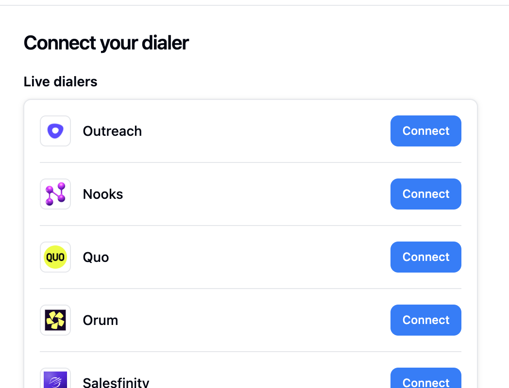

Connect Salesfinity so that Ergo receives your calls. One connection serves the whole organization. You enter an API key in Ergo and make a webhook in Salesfinity.

## Who can use this

- The organization **Owner** and team **Admins**.

## Before you start

- Have the Salesfinity team API key ready.

## Steps

1. Sign in to Ergo as the Owner or a team Admin.
2. Open **Settings → Org integrations**. In **Dialers**, find **Salesfinity** and select **Connect**.
3. In the dialog **Connect Salesfinity Dialer**, paste the key in **Team API key** and select **Connect**.
4. Select **Copy** next to the **Webhook URL** that Ergo now shows.
5. In Salesfinity, open **Settings → Connections → Webhooks** and select **Create Webhook**. Name it **Ergo Call Import**.
6. Set the event to **Call Logged**. Select all call dispositions.
7. Paste the Ergo URL in **Post URL** and save the webhook.
8. In Ergo, select **Done**. Then make one test call and look for it in **Meetings**.

## What to expect

- The label **Connected** shows that Ergo saved the API key. It does not show that calls arrive.
- No call arrives until you make the webhook in Salesfinity.
- When you select all call dispositions, Ergo receives every eligible call, also calls with custom dispositions.

## Common issues

- No calls arrive: the webhook is missing in Salesfinity, or the event is not **Call Logged**.
- Some calls are missing: not all call dispositions are selected in the webhook.
- You do not see **Connect**: only the Owner or a team Admin can connect a dialer.

## Related articles

- [Outreach](https://support.joinergo.com/articles/4534096844)
- [Nooks](https://support.joinergo.com/articles/6672173844)
- [Meeting processing time and status states](https://support.joinergo.com/articles/3507520478)
- [Get support](https://support.joinergo.com/articles/2708243049)
