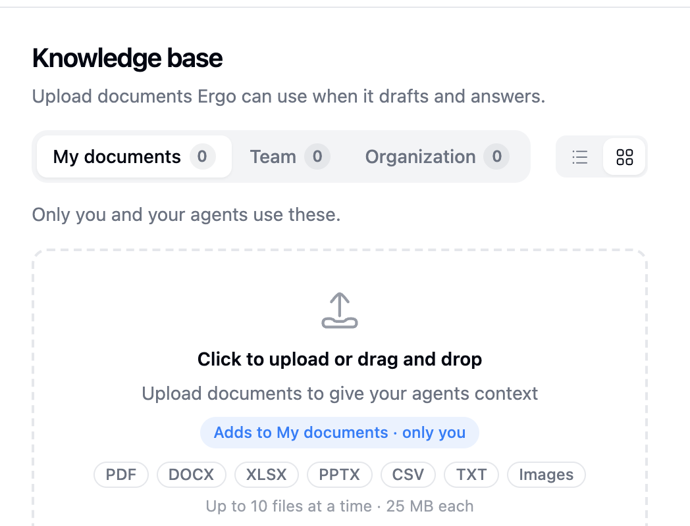

Upload playbooks, FAQs and policies so that Ergo agents can use them when they draft and answer.

## Who can use this

- People with a Standard seat. **Knowledge Base** is in **Settings** only for these seats.
- All users can add to **My documents**. Only team Admins can add to their team. Only the Owner and Admins can add to **Organization**.

## Before you start

- Decide who needs the document: only you, a team, or the organization.
- A document in **My documents** is for you only. A document in **Team** is shared with everyone on that team. A document in **Organization** is shared with everyone in the organization.
- Other users can view and download team and organization documents.

## Steps

1. Open **Settings → Knowledge Base**.
2. Select a tab: **My documents**, **Team** or **Organization**. On the **Team** tab, select the team if you are in more than one team.
3. Click the upload area (**Click to upload or drag and drop**), or drag the files into it. The chip in the area shows where the files go, for example **Adds to My documents · only you**.
4. Wait until **Uploading...** and **Processing...** go away. Then the document is ready.
5. Read the **Document summary**. To change it, click the **Edit summary** icon, change the text, then click **Save**.
6. If the document shows **Indexing failed**, click the **Retry indexing** icon.

## What to expect

- Ergo accepts these file types: PDF, Word (DOCX, DOC, DOTX, RTF), Excel (XLSX, XLS, XLSM), CSV, PowerPoint (PPTX, PPT), text (TXT, MD, HTML, JSON) and images (JPG, PNG, GIF, WEBP, BMP, TIFF, HEIC).
- Each file must be 25 MB or smaller. You can upload a maximum of 10 files at one time.
- Ergo reads the file and indexes its text. Then Ergo writes a **Document summary**. Your agents use the summary to decide when to read the document. You can edit the summary.
- A document that is ready has no label.

## Common issues

- The document shows **Indexing failed**. Put the pointer on the label to see the cause. Then retry.
- The tab you need does not let you add files. Your role does not allow it for that scope.
- Ergo does not use the document yet. Wait until it is ready.

## Related articles

- [Document status, retry, delete, and download](https://support.joinergo.com/articles/1723956985)
- [Post-call reference docs and summaries](https://support.joinergo.com/articles/7128580019)
- [Share or revoke documents](https://support.joinergo.com/articles/6142809448)
- [Link documents to deals](https://support.joinergo.com/articles/8458870168)
