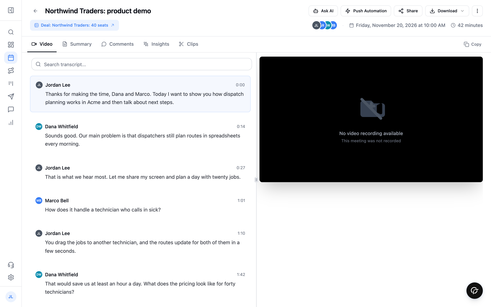

A meeting is not one all-or-nothing state. A recording can be ready while the transcript, summary, drafts or CRM updates are still pending.

## Who can use this

- Anyone who can open the meeting in **Meetings**.

## Steps

1. Open **Meetings** and read the text on the meeting row.
2. If the row shows **Recording generating...** (bot recording) or **Processing your recording...** (desktop recording), wait.
3. Open the meeting. Read the text on the **Summary** tab and in the transcript area.
4. If a desktop recording shows **Processing failed**, click **Retry** on the row.
5. If a follow-up draft or CRM update is missing, click **Recent activity** on **Dashboard**. Find the meeting in the **Activity Log**.
6. To run the automations again, open the meeting and click **Push Automation**.

## What to expect

- Ergo has no fixed processing time. Wait for the output that you need.
- **Recording is processing** shows on the meeting page while the recording is not ready.
- **Recording complete — no transcript available** shows when the audio was not captured.
- The **Summary** tab shows the summary when it is ready.
- For a call with no business content, the summary says "This meeting was classified as not relevant — no substantive business content was detected." A no-show has the **No Show** badge.
- **Retry** works for a desktop recording that shows **Processing failed**, and for an upload that failed. A bot recording has no **Retry** button.

## Common issues

- The transcript is missing: the bot did not join, nobody admitted it, or the audio was not captured.
- The desktop app shows **Upload failed**: open **Meetings**. When the row shows **Processing failed**, click **Retry**.
- A meeting is not in **Meetings**: look for a row with the chip **N captures**. Ergo shows two captures of one meeting as one row.
- A meeting is not in **Meetings**: ask the organization **Owner** if **Time-Based Deletion** is on, or if a privacy rule hides the meeting.
- The page shows **Meeting not accessible**: ask the Owner or your team **Admin** to open **Settings → Members**, click your name, and click **Edit** in **Meeting access**.
- Still stuck: use the **Support** button. Give the meeting title, the source and the missing output.

## Related articles

- [Why some meetings do not generate insights or drafts](https://support.joinergo.com/articles/1207359797)
- [Delete or retry processing](https://support.joinergo.com/articles/3559756999)
- [Meeting detail page](https://support.joinergo.com/articles/5822103848)
- [Troubleshoot missed detection or upload failures](https://support.joinergo.com/articles/5749782951)
- [Get support](https://support.joinergo.com/articles/2708243049)
