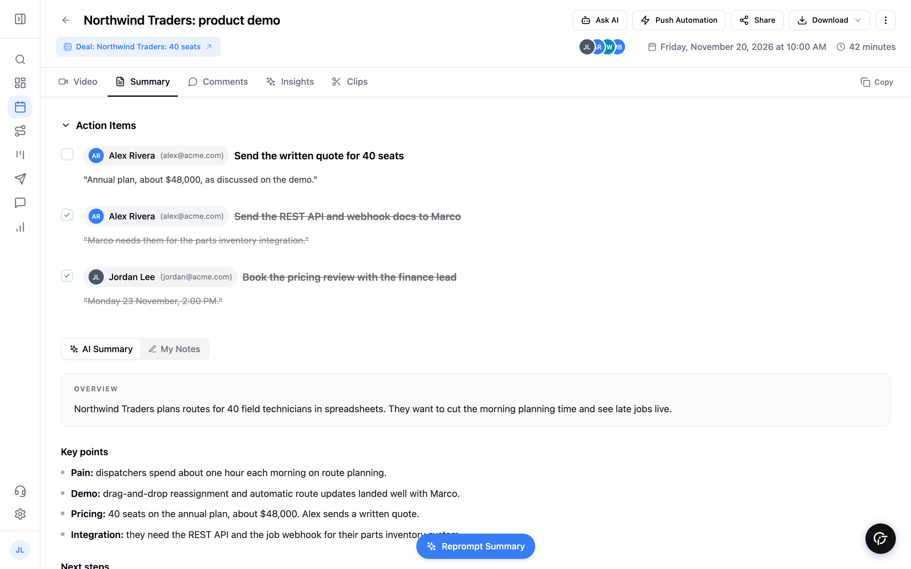

Use **Push Automation** when a meeting or a note needs the automations that did not run automatically.

## Who can use this

- A **Standard** seat. Other seats do not have the button.
- For a meeting: the organization **Owner**, the meeting owner or an internal attendee.
- For a note: only the person who wrote it.

## Before you start

- Make sure that the meeting has a transcript and at least one external attendee email.
- You cannot push a meeting that is locked private by organization policy.

## Steps

1. Open the meeting.
2. Select **Push Automation** at the top right. In a narrow window, select **⋮ (More actions) → Push Automation**.
3. In the **Push to Automations** dialog, check the email addresses of the external attendees.
4. To add an address, type it and press Enter. Ergo adds your address automatically.
5. Select **Push to Automations**.
6. Make sure that Ergo shows "Meeting sent to automation successfully".
7. For a note in the desktop app: add an attendee from outside your company, select **Push Automation**, then select **Push**.

## What to expect

- A push does not use the sales-meeting filter.
- A push always runs the automations again, also when they ran before for this meeting or for another capture of it.
- Ergo ignores a second push of the same meeting for 2 minutes.
- **Push to CRM** on an uploaded recording opens the same dialog.
- Review the generated output before you use it.

## Common issues

- The success message shows, but nothing runs: the meeting has no transcript, or it has no external attendee. Ergo accepts the push, but the automations do not run.
- No button: you do not have a Standard seat, or you are not the owner or an attendee.
- Duplicate output: another capture of the same meeting already ran. Push only when you want to run the automations again.

## Related articles

- [Why some meetings do not generate insights or drafts](https://support.joinergo.com/articles/1207359797)
- [Using multiple notetakers with Ergo](https://support.joinergo.com/articles/3534048190)
- [Upload external recordings](https://support.joinergo.com/articles/5256639340)
- [Manual notes](https://support.joinergo.com/articles/7787263112)
