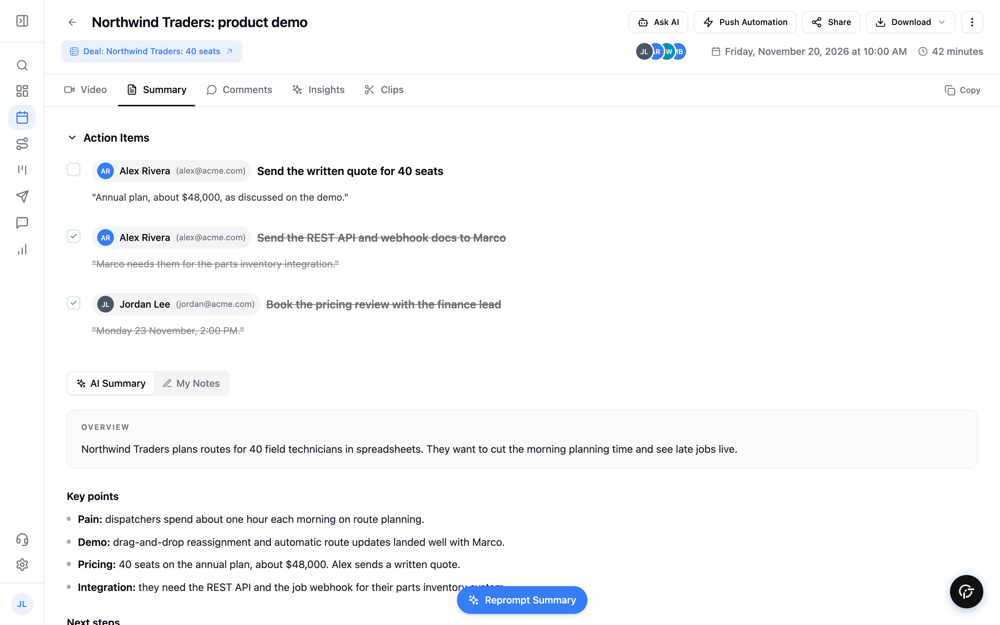

The **Share Meeting** dialog has two functions. **Share with your organization** lets everyone in your organization find and view the meeting. A share link lets people outside Ergo open the meeting.

## Who can use this

- Only the meeting owner or an internal attendee can change the **Share with your organization** switch.

## Steps

1. Open **Meetings** and open the meeting.
2. Select **Share** at the top right. The **Share Meeting** dialog opens.
3. To let everyone in your organization find and view the meeting, turn on **Share with your organization**.
4. To share with people outside Ergo, select **Generate Shared Link**, then select **Copy**.
5. To add a password, select **Add Password Protection**. Enter the password in **New Password** and **Confirm Password** (6 to 128 characters). Select **Save Password**.
6. To change or remove the password, select **Change Password** or **Remove**.
7. To stop access, select **Revoke Share Access**. The link and its password stop working at once.
8. To hide the meeting from colleagues also, select **⋮ (More actions) → Make Private**. This also removes the link.

## What to expect

- The dialog says "Anyone with this link can view the meeting content." Send the link only to the people you intend. Send the password separately.
- If you select **Share Again** after a revoke, Ergo makes a new link. The old link stays unusable.
- Ergo can ask a viewer to verify their email address with a one-time code. If the link has a password, the viewer must then enter it.
- A viewer sees the **Video** and **Summary** tabs and can use **Ask AI**. A viewer cannot see comments, insights or clips, and cannot download or share the meeting.
- A private meeting cannot be shared.

## Common issues

- You see "Public sharing is not allowed for this organization." Your organization does not allow public links. Use **Share with your organization**, if the switch is available.
- A meeting that is locked private by organization policy cannot be shared.

## Related articles

- [Meeting availability and visibility](https://support.joinergo.com/articles/9550556881)
- [Create and share clips](https://support.joinergo.com/articles/1584425350)
- [Summary emails and recording links](https://support.joinergo.com/articles/2971797649)
- [Meeting detail page](https://support.joinergo.com/articles/5822103848)
