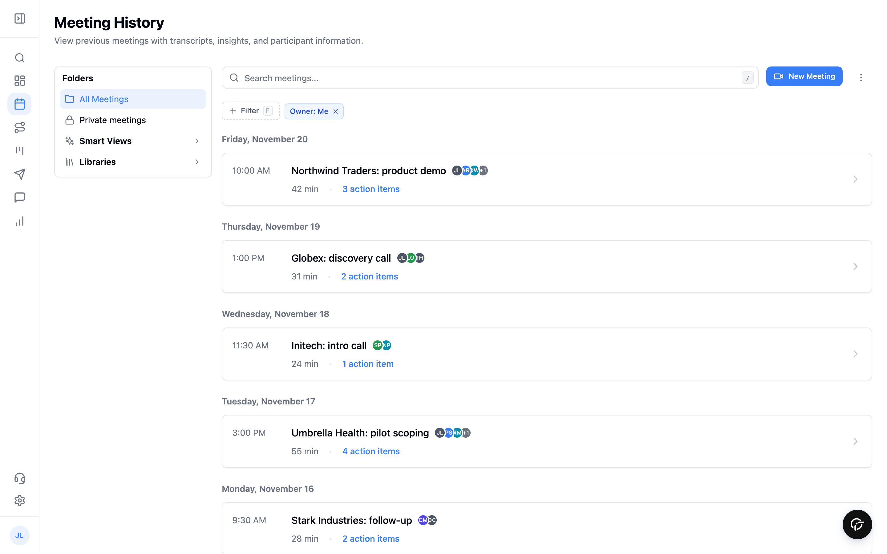

Use **Import Audio/Video** to add a recording that the Ergo bot did not capture. Ergo makes a transcript and adds the meeting to **Meeting History**.

## Who can use this

- People who can open **Meetings**. Running the automations for the upload needs a **Standard** seat.

## Before you start

- Make sure that you have the right to upload and process the recording.
- Use an MP3, WAV, M4A, OGG, WebM, MP4 or MOV file. The maximum size is 1.5 GB.
- Use a recording with enough clear audio for a transcript.

## Steps

1. Open **Meetings**.
2. Select **⋮ (More actions) → Import Audio/Video**.
3. Put the file in **Recording**.
4. In **Link to Calendar Event**, search for the past meeting and select it. Ergo fills in the name, date, time and attendees.
5. If the meeting is not in your calendar, enter the **Meeting Name**, **Date**, **Time** and **Attendees** (email addresses) manually.
6. Select **Import**. Keep the page open until the upload is complete.
7. Wait until the card at the top of **Meeting History** shows **Processing complete**.
8. To run your automations, select **Push to CRM**. Check the external attendee emails and select **Push to Automations**. Or select **Skip**.

## What to expect

- Ergo does not run your automations for an upload automatically.
- The meeting shows in **Meeting History** with the mark **Upload**.
- The meeting starts with no summary and no action items.
- To make a summary, open the **Summary** tab and use the summary bar.

## Common issues

- Import is not available: a field is empty, or the date is in the future.
- You left the page during the upload: the upload stops. The page warns "A file upload is still in progress."
- The card shows "Upload failed": select **Re-upload**.
- The card shows "Processing failed": select **Retry**. You do not upload the file again.
- The transcript is empty: the audio is missing, short or unclear.

## Related articles

- [Push notes or meetings to automations](https://support.joinergo.com/articles/9743385583)
- [Meeting processing time and status states](https://support.joinergo.com/articles/3507520478)
- [Meeting detail page](https://support.joinergo.com/articles/5822103848)
- [Meeting history and folders](https://support.joinergo.com/articles/7669432836)
