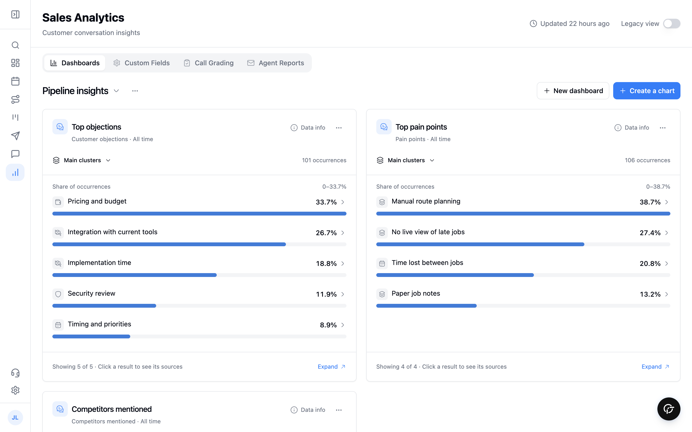

Filters and date ranges are the most common reason two people see different results. Check them before you compare charts.

## Who can use this

- Anyone with Reporting access can open drilldowns.
- Users with create access can change the filters of a chart.

## Steps

1. Select **Reporting** in the left navigation.
2. Find the chart. Select **⋯** → **Edit chart**.
3. Open **Filters**.
4. Set **Date range**, **Deal stage**, and any other filter.
5. Select **Save changes**.

## What to expect

- In the default view, each chart uses its own saved **Date range**. A dashboard-level **Time Range** button exists only in the **Legacy view**.
- Date ranges are **All time**, **Last 7 days**, **Last 30 days**, **Last 3 months**, **Last 6 months**, **Last 12 months**, and **Custom range**.
- The filters are: **Date range**; **Deal stage** (**All**, **Won**, **Lost**, **Open**, or **Choose stages**); field filters that you add with **Add filter**; and **Deal value** (**Minimum** and **Maximum**, both inclusive).
- Values in one filter are alternatives. Different filters must all match.
- If you change the reporting field and a filter does not apply, Ergo keeps the filter and shows **Conflicts with the main category**. Remove that filter. Then you can save the chart.

## Drilldowns

- Use the view menu on a chart: **Main clusters**, **All clusters**, **Won vs lost**, or, below **Focus on a cluster**, the subclusters of one main cluster.
- Select the number on a bar to open the list of occurrences.
- Each occurrence shows the quote, **View call**, and **View deal**.
- Select **Export CSV** to download the list.
- Use drilldowns to read the source before you use a chart for coaching or forecasting.

## Common issues

- Two charts disagree: compare the **Date range** and the filters of each chart.
- A chart looks empty: remove the filters one at a time. Make sure the field has data in that period.
- A shared dashboard link shows the same charts read-only. Viewers can open the quotes and the deals behind a bar. They cannot export a CSV. A call or a deal opens only after an Ergo sign-in. Forecast charts do not show on a shared link.

## Related articles

- [Reporting overview](https://support.joinergo.com/articles/7280561380)
- [Create/edit reports](https://support.joinergo.com/articles/3609942735)
- [Save widgets to dashboards](https://support.joinergo.com/articles/2123914242)
- [Share a dashboard](https://support.joinergo.com/articles/3282621663)
- [Search/reporting has no results](https://support.joinergo.com/articles/8146112124)
