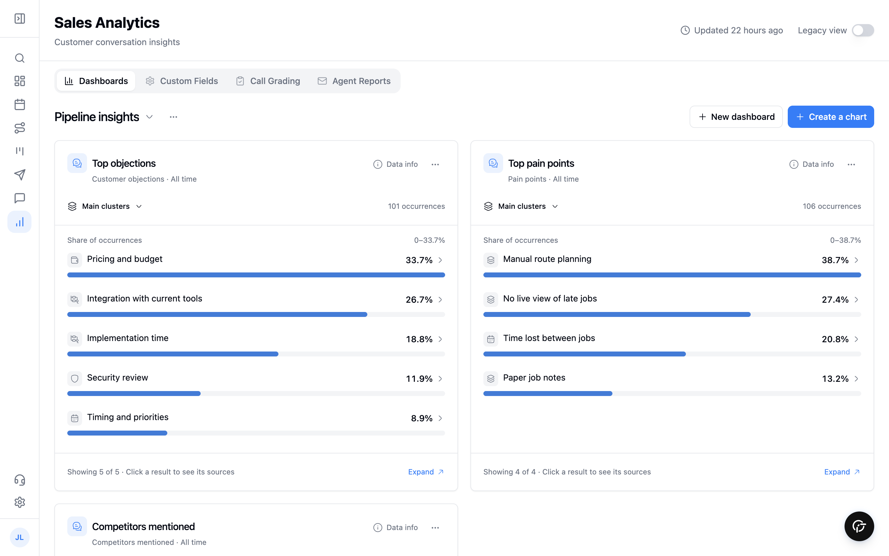

Reporting shows analytics from your customer conversations. Use it to review dashboards, fields, call grading and scheduled report emails.

## Who can use this

- Reporting is an add-on. Ergo turns it on for your organization.
- When Reporting is on, the organization Owner and each team Admin can open **Reporting**, see all dashboards, and create dashboards, charts, fields and rubrics.
- A Member can open **Reporting** only after the Owner gives access: **Settings → Members** → select the member → **Reporting access** → **Grant**.
- If you do not see **Reporting** in the left navigation, you do not have access.

## What appears in Reporting

- **Dashboards**: saved collections of charts.
- **Custom Fields**: sentence and picklist fields that Ergo fills from your meetings. Use them as chart fields, breakdowns or filters.
- **Call Grading**: scorecards (rubrics) that you can use in charts.
- **Agent Reports**: weekly report emails with fields that you select or that Ergo selects. The Owner and team Admins see this tab.
- **Rep Performance**: shows only if Ergo has turned it on for your organization.

## Steps

1. Select **Reporting** in the left navigation. The page title is **Sales Analytics**. The **Dashboards** tab opens first.
2. Choose the dashboard that you want to read.
3. Read the line below each chart title. It shows the field, the date range and the filters of that chart.
4. Open a chart to check the field, the breakdown and the chart type.
5. Use drilldowns or source evidence before you make a coaching or pipeline decision.

## What to expect

- If you see **Building Your Analytics**, Ergo does not have 50 conversations yet. The dashboards show after that.
- A dashboard-level **Time Range** button exists only in the **Legacy view**. Use the **Legacy view** switch on the **Dashboards** tab.
- Filters and access grants change what each person sees.
- A shared link can show less than the **Reporting** page.

## Related articles

- [Default dashboards](https://support.joinergo.com/articles/7968597484)
- [Filters, time ranges, and drilldowns](https://support.joinergo.com/articles/2899052555)
- [Create/edit reports](https://support.joinergo.com/articles/3609942735)
- [Grant meeting or reporting access](https://support.joinergo.com/articles/3277963384)
- [Search/reporting has no results](https://support.joinergo.com/articles/8146112124)
