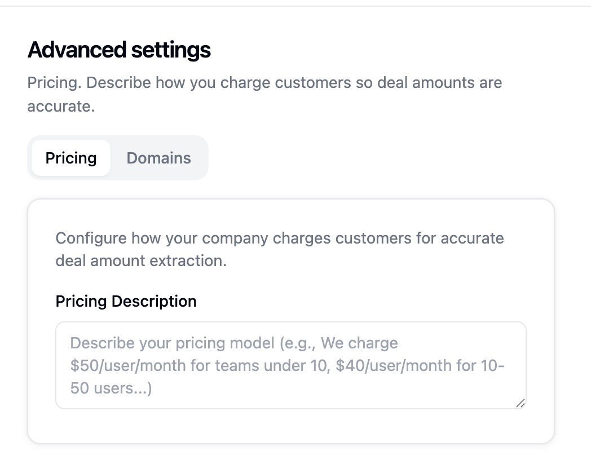

**Settings → Advanced** has organization-wide defaults: how deals qualify, how you price, and which domains count as yours.

## Who can use this

- The organization **Owner** and team **Admins**. **Pricing** is Owner only.

## Before you start

- Advanced settings are optional. You can skip the wizard step and come back later.

## Steps

1. Open **Settings → Advanced** (wizard step **Advanced settings**).
2. **Deal Qualification** (only for some organizations): select a preset or click **Add Criterion**. Turn on **Enabled**. See [Deal qualification](https://support.joinergo.com/articles/3930889755).
3. **Pricing** (Owner only): fill **Pricing Description**. Ergo uses it to get deal amounts right.
4. **Domains**: add your other company domains to **Alternate Domains**, and the domains of your partners to **Partnership Domains**. Type a domain and press Enter.
5. **Salesforce** (Owner, only with Salesforce): read the status of **Salesforce CDC Sync**.

## What to expect

- Not all organizations see all tabs.
- CRM logging, deal creation and update sensitivity are not on this page. They are in **Settings → CRM Settings → CRM behavior**, for each team: **CRM Logging** (**CRM Email Objects**, **CRM Slack Objects**), **Prevent automatic deal creation during selection** and **CRM Update Sensitivity** (**Conservative**, **Medium**, **Aggressive**).
- Each person adds their own other email addresses in **Settings → Profile → Alternate emails**.

## Common issues

- No **Deal Qualification** tab: the feature is not on for your organization.
- You cannot edit **Pricing**: only the Owner can.
- A customer is treated as internal: you added a customer domain to **Alternate Domains**. Remove it. See [Alternate domains/emails](https://support.joinergo.com/articles/9300714064).

## Related articles

- [Deal qualification](https://support.joinergo.com/articles/3930889755)
- [Alternate domains/emails](https://support.joinergo.com/articles/9300714064)
- [Company details](https://support.joinergo.com/articles/8760194863)
- [First-time setup checklist](https://support.joinergo.com/articles/9947439335)
