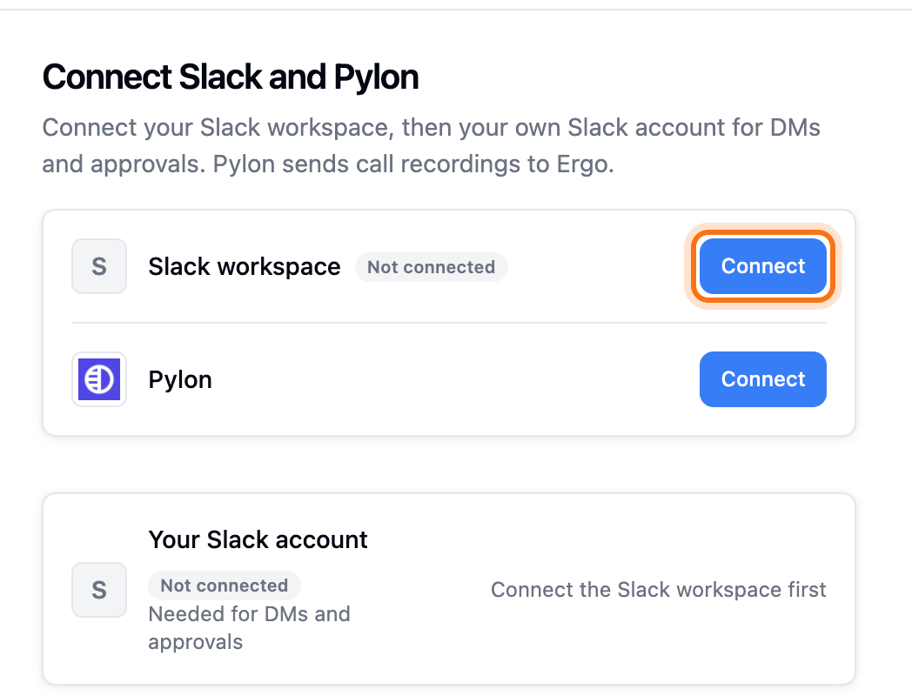

Connect Slack and Pylon so Ergo can use Slack channels, send pre-call DMs and send meetings to Pylon.

## Who can use this

- An **Owner** or team **Admin** with a **Standard** seat connects the Slack workspace.
- Then each person with a **Standard** or **Notetaker** seat connects their own Slack account.
- The **Owner** and team **Admins** connect Pylon.
- A **Spectator** seat cannot connect Slack.

## Before you start

- Know which Slack workspace your team uses. Check the workspace name on the Slack approval screen.
- Connect email, calendar, CRM and notetaker separately. Slack does not replace them.

## Steps

1. Open **Settings → Org integrations → Workspaces**. In the setup wizard, this is the step **Connect Slack and Pylon**.
2. Click **Connect** on the **Slack** row. Make sure that the workspace is correct. Then approve.
3. In the **Enable Slack Monitoring** window, click **Enable** to let Ergo update your CRM from Slack channels. Or click **Skip**.
4. Connect your own Slack account: open **Settings → User integrations → Slack** and click **Connect**.
5. In **Org integrations**, click the gear icon on the **Slack** row. In **Slack settings**, click **Pick channels** next to **Channels Ergo watches**. Select the channels.
6. Each person turns on **Pre-call context DM**: open **Settings → User integrations → Slack**, click the gear icon, and use **Slack settings**.
7. For Pylon, click **Connect** on the **Pylon** row. Paste the key in **Pylon API key**. Click **Connect**.
8. Test with one channel and one meeting.

## What to expect

- The **Slack** row shows **Connected** and the workspace name.
- **Pick channels** is off until you connect your own Slack account. Until the workspace is connected, the user row reads "Your admin needs to connect Slack first".
- **Pre-call context DM** sends you a Slack DM ten minutes before each external meeting. It shows the attendees, the last touchpoint and the open items.
- In **Slack settings**, the **Owner** and team **Admins** also see **Channel associations**.
- The **Pylon** row shows **Connected**. The **Owner** can click the gear icon to select whose completed meetings Ergo sends to Pylon.
- Ergo sends meetings to Pylon. Pylon is not a CRM source.

## Common issues

- Wrong Slack workspace: disconnect Slack and connect again. Check the workspace on the approval screen.
- A channel is missing: add Ergo to the channel and make sure that your Slack account has access. See [Add Ergo to new Slack customer channels](https://support.joinergo.com/articles/5430278897).
- No CRM context from Slack: check that **Slack monitoring** is on and that Ergo watches the channel.
- No pre-call DM: check that your calendar and Slack are connected, that the meeting is external, and that **Pre-call context DM** is on.
- Pylon does not receive meetings: see [Pylon delivery failures, duplicate deliveries, and queue health](https://support.joinergo.com/articles/3902347572).

## Related articles

- [Slack](https://support.joinergo.com/articles/7075762783)
- [Slack monitoring and pre-call context](https://support.joinergo.com/articles/8418853270)
- [Pylon](https://support.joinergo.com/articles/6049381167)
- [Google/Microsoft/Slack reconnects](https://support.joinergo.com/articles/5648164253)
- [Slack disconnect/reconnect and stale channel mappings](https://support.joinergo.com/articles/7906621776)
- [First-time setup checklist](https://support.joinergo.com/articles/9947439335)
