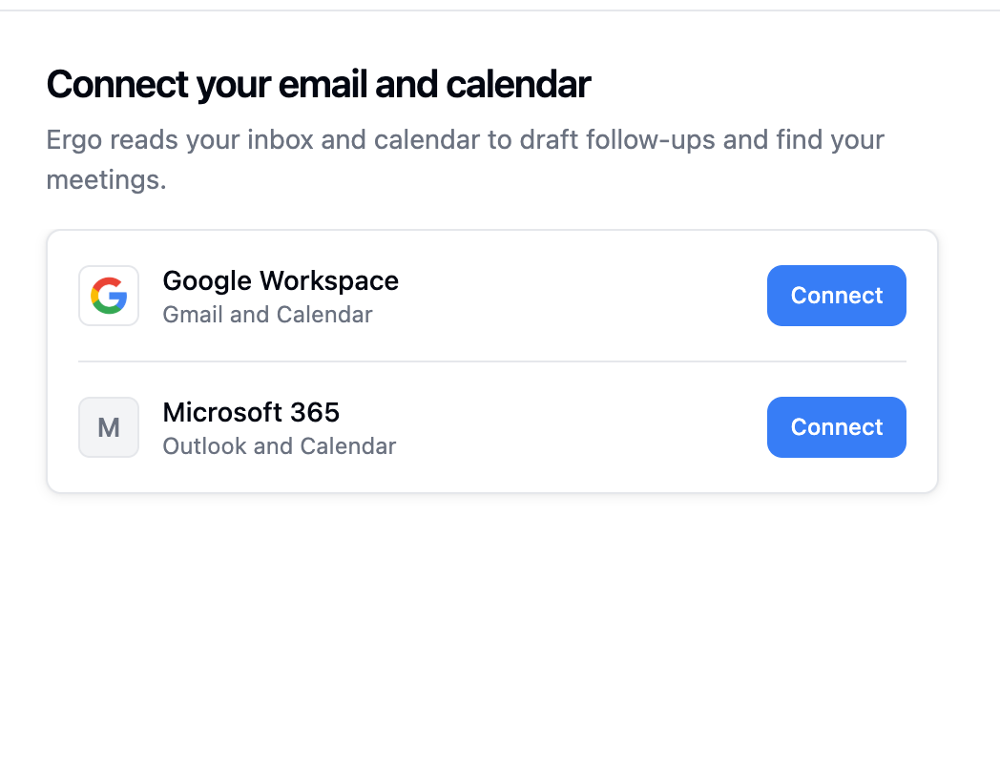

Connect your work email and calendar. Ergo uses them to find your meetings and to draft follow-up emails.

## Who can use this

- Each person, for their own account: Owner, team Admin and Member.
- A **Notetaker** seat can connect email and calendar, but has no **Email Drafting** page.
- A **Spectator** seat cannot connect email or calendar.

## Before you start

- Use the same email address that you use to sign in to Ergo. Ergo refuses a different address.
- You can connect **Google Workspace** or **Microsoft 365**, not both.

## Steps

1. In the setup wizard, open **Connect your email and calendar**. After setup, open **Settings → User integrations → Email & calendar**.
2. Click **Connect** in the row **Google Workspace** or **Microsoft 365**. If the other one is connected, click **Disconnect** on that row first.
3. Sign in to your work account and approve the email and calendar permissions.
4. Go back to Ergo. Make sure that the button is now **Disconnect** and that the row shows your email address.
5. Open **Settings → Email Drafting → General**. Below **What Ergo does with your mailbox**, set the switches (see below).
6. Open **Meetings** and make sure that your next customer meeting shows.

## What to expect

The switches in **Settings → Email Drafting → General** (Standard seat only):

- **Post-call follow-up emails:** Ergo drafts a follow-up after each external meeting. Off for a new seat.
- **Email analysis:** Ergo reads relevant emails to update your CRM. Off for a new seat.
- **Email inbox flow (triage):** Ergo sorts customer threads in your inbox and drafts replies for you to send.
- **Draft replies to internal emails:** turn it off to stop reply drafts for people from your own company.

Each switch saves at once. There is no **Save** button.

## Common issues

- Ergo refuses the account: you signed in with a different email address. Connect the account that you use to sign in to Ergo.
- The row shows **Expired**: click **Reconnect** and sign in with the same account.
- The other provider button is off: disconnect the first provider.
- No drafts: make sure that **Post-call follow-up emails** is on, and that **Settings → Profile → Process my meetings, emails and Slack** is on.

## Related articles

- [Notetaker setup](https://support.joinergo.com/articles/1280940465)
- [Turn post-call drafts on or off](https://support.joinergo.com/articles/3684399934)
- [How to onboard to Ergo](https://support.joinergo.com/articles/9947439335)
- [Google Workspace](https://support.joinergo.com/articles/9333675093)
- [Microsoft 365](https://support.joinergo.com/articles/9353990784)
