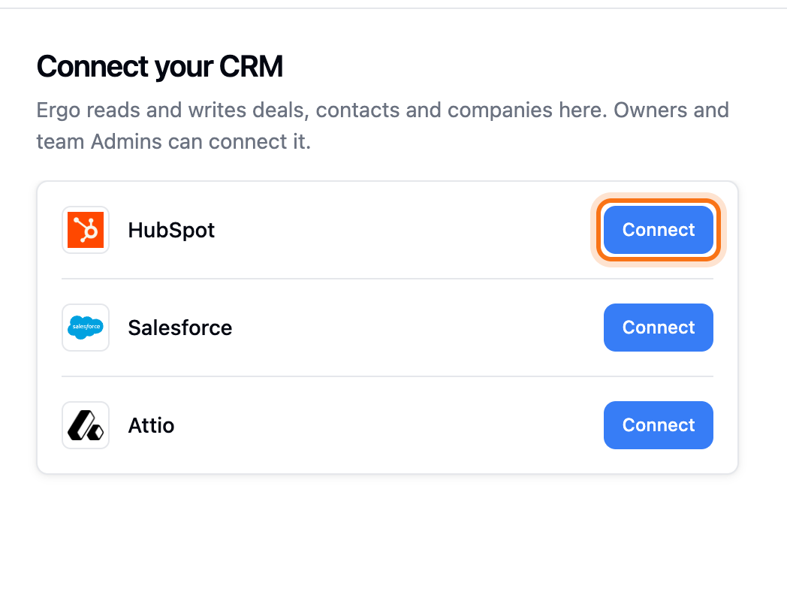

Connect the CRM that Ergo reads and writes for your whole organization. Then select the fields and stages that Ergo uses.

## Who can use this

- The organization **Owner** and team **Admins**. A **Member** cannot connect the CRM.
- The seat type does not matter. An Owner or Admin with a **Spectator** seat connects the CRM in **Settings → Org integrations** (a Spectator seat has no setup wizard).

## Before you start

- Choose your CRM: **HubSpot**, **Salesforce** or **Attio**. You can connect only one CRM.
- The rows **Ergo CRM**, **Bullhorn** and **Pipedrive** show only when Ergo turns them on for your organization. Contact Ergo support if you need one.
- Use a CRM account that can read and update deals, contacts, companies, pipelines and stages.

## Steps

1. Sign in as the Owner or as a team Admin.
2. In the setup wizard, open step 1, **Connect your CRM**. After setup, open **Settings → Org integrations → CRM**.
3. Click **Connect** in the row of your CRM.
4. Approve the connection in your CRM. Your browser comes back to Ergo.
5. Make sure that the row shows **Connected**. The **Connect** buttons of the other CRMs are then off.
6. Open **Settings → CRM Properties** (wizard step **CRM properties**). Click **Sync From CRM**, select the fields, and click **Sync Selected Properties**.
7. Open **Settings → CRM Stages** (wizard step **CRM stages**). Click **Sync From CRM**, select the stages, and click **Sync Stages**. Then click **Stage Settings**, turn on **Entry Point** for one stage in each pipeline, and click **Save Changes**.
8. Open **Settings → CRM Settings → Permissions**. Make sure that **Allow creation** and **Allow updates** are correct for **Deal**, **Contact** and **Company**. All are on at the start.

## What to expect

- Ergo sets record owners automatically. Owner fields are not in the sync list.
- A connected CRM does not mean that Ergo writes every field. Each field has a **Write behavior**. **Amount** and **Close Date** start as **Ergo will never write to this field**.
- Field and stage setup is for one team. Select the team at the top right of each CRM page.

## Common issues

- No **Connect** button: you are a Member. Ask the Owner or a team Admin.
- Ergo creates no new deals: a pipeline has no **Entry Point**. See [Pipeline stages](https://support.joinergo.com/articles/1501601101).
- A field does not update: check its **Write behavior** in **Settings → CRM Properties**.
- The wrong CRM account was connected: click **Disconnect**, then connect again with the correct account.

## Related articles

- [CRM properties setup](https://support.joinergo.com/articles/3371162277)
- [Pipeline stages](https://support.joinergo.com/articles/1501601101)
- [First-time setup checklist](https://support.joinergo.com/articles/9947439335)
- [HubSpot](https://support.joinergo.com/articles/7579052434)
- [Salesforce](https://support.joinergo.com/articles/2093487681)
- [Attio](https://support.joinergo.com/articles/2302656680)
- [CRM sync issues](https://support.joinergo.com/articles/6503095041)
