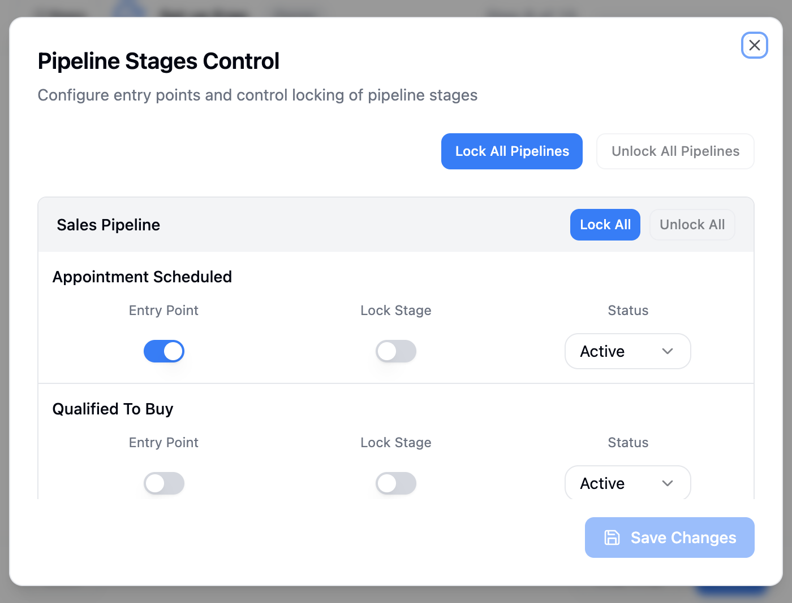

Sync the pipelines and stages from your CRM. Then set where new deals start. Without an entry point, Ergo does not create new deals.

## Who can use this

- The organization **Owner** and team **Admins**.
- Stage settings are for one team. Select the team at the top right of the page.

## Before you start

- Connect the CRM first. See [Connect your CRM](https://support.joinergo.com/articles/2772377599).

## Steps

1. Open **Settings → CRM Stages** (wizard step **CRM stages**). Select the team at the top right.
2. Click **Sync From CRM**. In **CRM Pipeline Stages**, select the stages that your team uses.
3. Keep **Auto-generate descriptions** selected and click **Sync Stages**.
4. Click **Stage Settings**. In the setup wizard this window opens by itself after the sync.
5. In **Pipeline Stages Control**, turn on **Entry Point** for the stage where a new deal starts. Each pipeline must have one.
6. Set **Lock Stage** and **Status** (**Active**, **Won**, **Lost**, **Inactive**) if necessary. Click **Save Changes**.
7. Open each stage. Check **Description** and **Exit Points**.

## What to expect

- A synced stage starts with **Entry Point** off, **Lock Stage** off and status **Active**.
- **Save Changes** stays off while a pipeline has no entry point (unless all its stages are locked).
- Each stage gets the later stages of the same pipeline as its **Exit Points**.
- To have the deal owner approve each stage move, click the **⋯** button and select **Require approval before moving deals**.
- To add the default Ergo stages, click **Add Default**. Ergo does not make a stage two times.

## Common issues

- No new deals: a pipeline has no **Entry Point**. The page shows **Pipeline entry point required**.
- A stage is missing: the sync window only adds stages. Click **Sync From CRM** again and select it.
- A stage row shows **Resolve Conflict**: the stage changed in your CRM. Click it and choose which version to keep.

## Related articles

- [Connect your CRM](https://support.joinergo.com/articles/2772377599)
- [CRM properties setup](https://support.joinergo.com/articles/3371162277)
- [Stage controls](https://support.joinergo.com/articles/4806151015)
- [CRM sync issues](https://support.joinergo.com/articles/6503095041)
