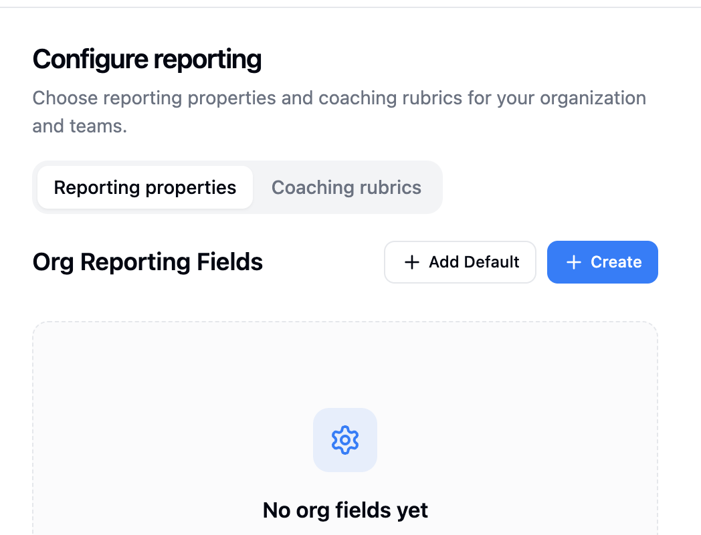

Use this page when Reporting is part of your first rollout. The setup wizard adds fields and rubrics. It does not make dashboards.

## Who can use this

- The **Owner** and team **Admins**, if your organization has Reporting.
- Only the **Owner** gives Reporting access to other people.
- A **Member** never gets the **Configure reporting** step.

## Before you start

- Check that your organization has Reporting. If the step **Configure reporting** does not show, it does not.
- Decide if you want call grading.

## Steps

1. In the setup wizard, open the last step, **Configure reporting**.
2. On the **Reporting properties** tab, click **Add Default** to add the recommended fields. Or click **Create** to make your own. Do this for the organization and for each team.
3. On the **Coaching rubrics** tab, click **Add template** or **Create rubric**.
4. Click **Finish**.
5. After setup, open **Reporting**. Use the **Custom Fields** and **Call Grading** tabs to change fields and rubrics.
6. To add a default dashboard, open **Reporting → Dashboards** and turn on **Legacy view** at the top right. Click **Add Default Dashboard**. Select **Sales Default Dashboard**, **Customer Success Dashboard** or **Product Dashboard**.
7. Owner: open **Settings → Members**, click the person, and click **Grant** next to **Reporting access**.

## What to expect

- **Add Default Dashboard** does not show in the new Reporting view. It shows only with **Legacy view** on and with the right to create.
- In the **Reporting access** window, select **All dashboards** or **Specific dashboards**. Select **Can create dashboards, fields, and rubrics** if the person must make reports.
- An **Owner** and team **Admins** have all dashboards already.
- Default dashboards need enough meeting and CRM data before the results mean something.

## Common issues

- A person cannot see **Reporting** in the left navigation: Reporting access is missing. See [Grant meeting or reporting access](https://support.joinergo.com/articles/3277963384).
- A dashboard looks empty: a filter, team, time range or missing data hides the results. See [Search/reporting has no results](https://support.joinergo.com/articles/8146112124).
- You cannot find **Add Default Dashboard**: turn on **Legacy view**.
- A dashboard is visible to an **Admin** but not to another person: the grant is for specific dashboards only.

## Related articles

- [Reporting overview](https://support.joinergo.com/articles/7280561380)
- [Default dashboards](https://support.joinergo.com/articles/7968597484)
- [Create/edit reports](https://support.joinergo.com/articles/3609942735)
- [Call grading rubrics](https://support.joinergo.com/articles/3553693942)
- [Custom reporting fields](https://support.joinergo.com/articles/6979568726)
- [First-time setup checklist](https://support.joinergo.com/articles/9947439335)
