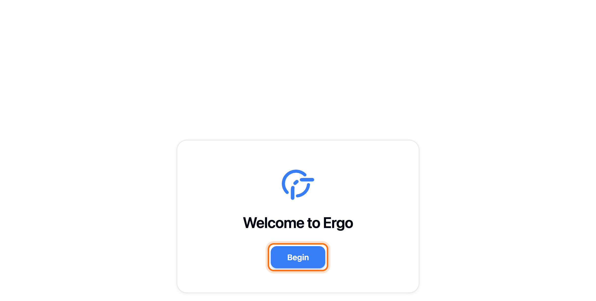

Onboarding has two parts. First the organization **Owner** sets up the shared tools and the CRM. Then each person sets up their own account. Ergo opens a setup wizard at each person's first sign-in, with the steps for their role and seat.

## Which guide is for you

- **Owner** (the person who sets up Ergo for the company): [Admin onboarding guide](https://support.joinergo.com/articles/1446541507).
- **Team Admin** (manages one team): [Admin onboarding guide](https://support.joinergo.com/articles/1446541507), section **If you are a team Admin**.
- **Rep** (Member role, Standard seat): [Rep onboarding guide](https://support.joinergo.com/articles/9716285693).
- **Notetaker seat** or **Spectator seat**: [Rep onboarding guide](https://support.joinergo.com/articles/9716285693), end of the guide.

Not sure of your role or seat? Open **Settings → Profile**. The **Access** section shows them.

## The order

1. **Owner:** sign in at dashboard.joinergo.com and do the [Admin onboarding guide](https://support.joinergo.com/articles/1446541507). Connect the CRM and set an **Entry Point** in each pipeline. Then add your team in **Add your team**.
2. **Team Admins:** sign in and do the wizard for your team.
3. **Reps:** sign in and do the [Rep onboarding guide](https://support.joinergo.com/articles/9716285693). Ergo does not send an invite email, so the Owner tells each person to sign in.
4. **Test:** record one external meeting. Check the summary in **Meetings**, the draft in **Drafts** and the update in your CRM.

| Role or seat | Wizard steps |
|---|---|
| Owner | 14 steps (15 with Reporting) |
| Team Admin | The Owner steps without **Connect your CRM** and **Connect your dialer** |
| Member | **Connect your email and calendar**, **Set up your notetaker**, **Connect Slack**, **Email and drafting**, **Knowledge base**, **Automations** |
| Notetaker seat | **Connect your email and calendar**, **Turn on the Ergo Notetaker** |
| Spectator seat | No wizard. The app opens at once. |

## What to expect

- The header shows **Set up Ergo**, your role and **Step n of N**. The footer has **Back**, **Skip step** and **Next** (**Finish** on the last step).
- **Next** marks a step done, also if you connected nothing. Use **Skip step** for a step that you do not need now.
- After **Finish**, the wizard does not open again. Make later changes in **Settings**.
- If a connection is missing after the wizard, the **Dashboard** shows the card **Get Ergo working**. Click the button in each row.

## Common issues

- A rep sees no CRM step. This is correct: the Owner or a team Admin connects the CRM for the organization.
- No new deals are created. Open **Settings → CRM Stages → Stage Settings** and turn on an **Entry Point** in each pipeline.
- A person skipped a step. Open **Settings → User integrations** (personal tools) or **Settings → Org integrations** (shared tools).
- No drafts after calls. Each rep must turn on **Post-call follow-up emails** in **Settings → Email Drafting → General**. It starts off.

## Related articles

- [Admin onboarding guide](https://support.joinergo.com/articles/1446541507)
- [Rep onboarding guide](https://support.joinergo.com/articles/9716285693)
- [Welcome to Ergo](https://support.joinergo.com/articles/2900823248)
- [Seats, roles and visibility](https://support.joinergo.com/articles/6821509431)
- [Get support](https://support.joinergo.com/articles/2708243049)
