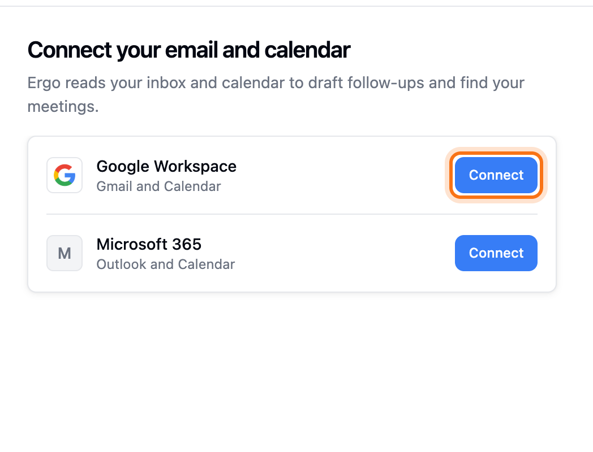
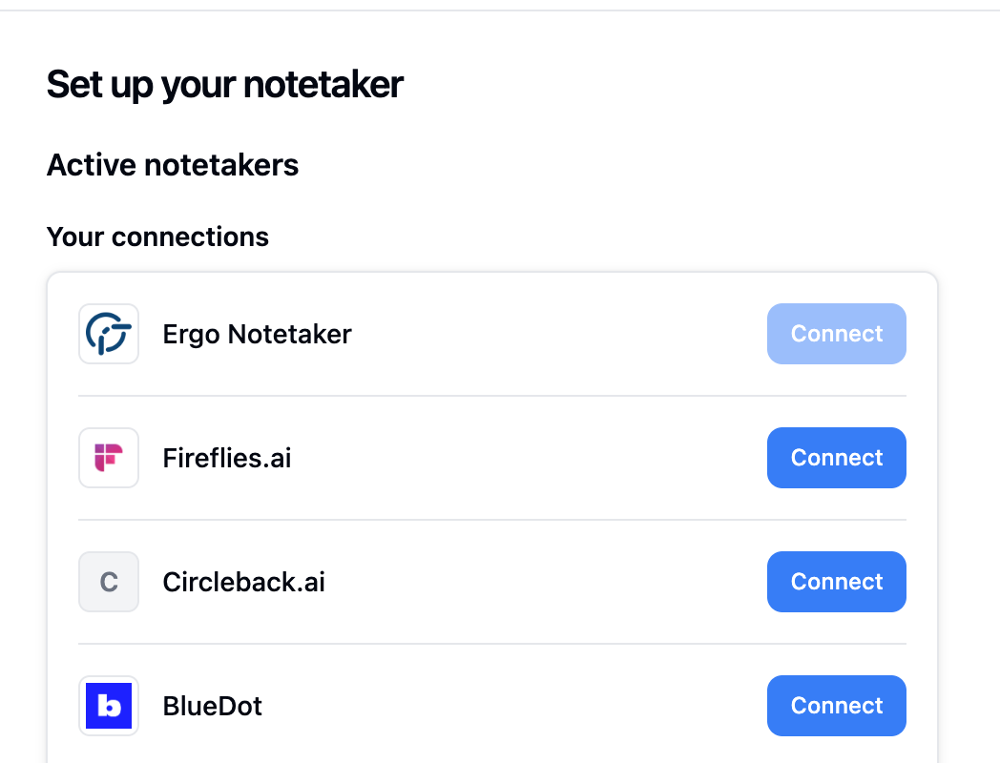
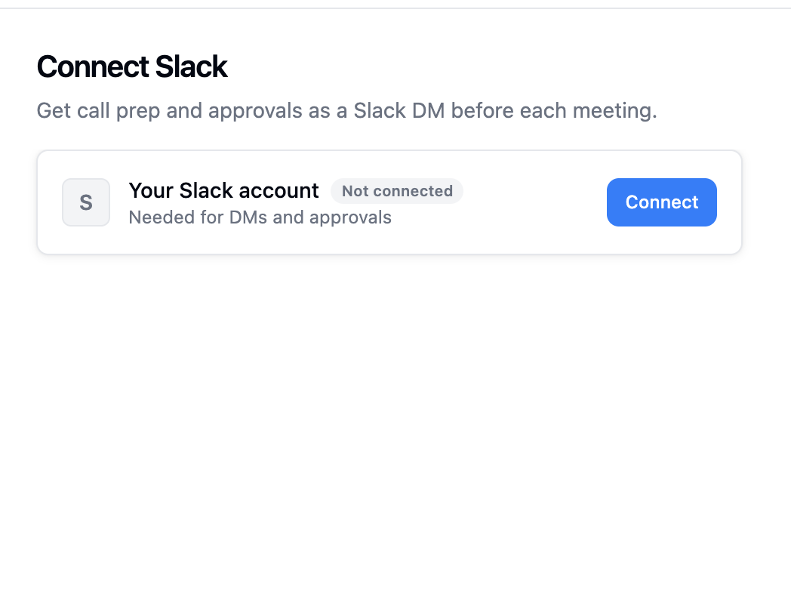
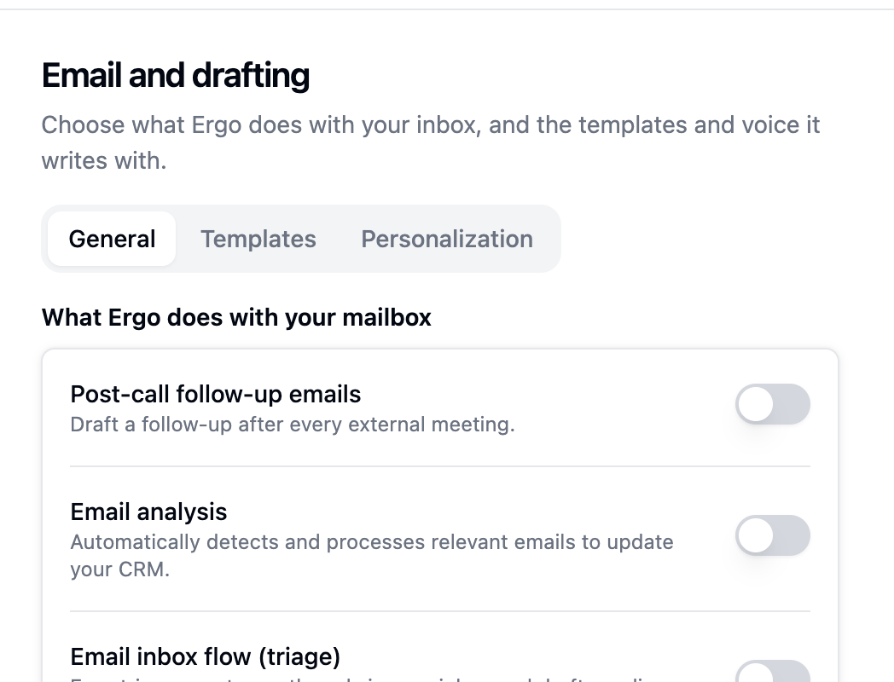
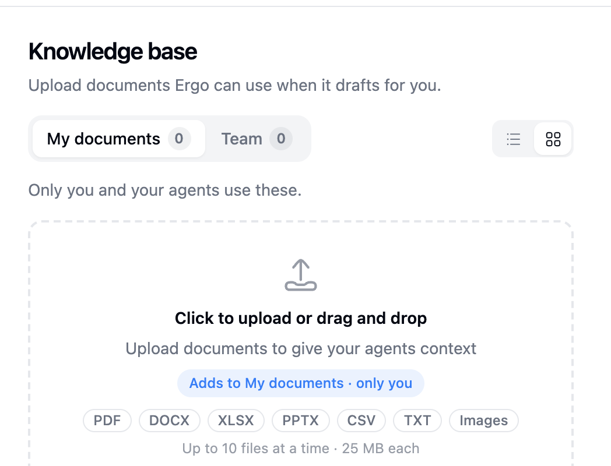
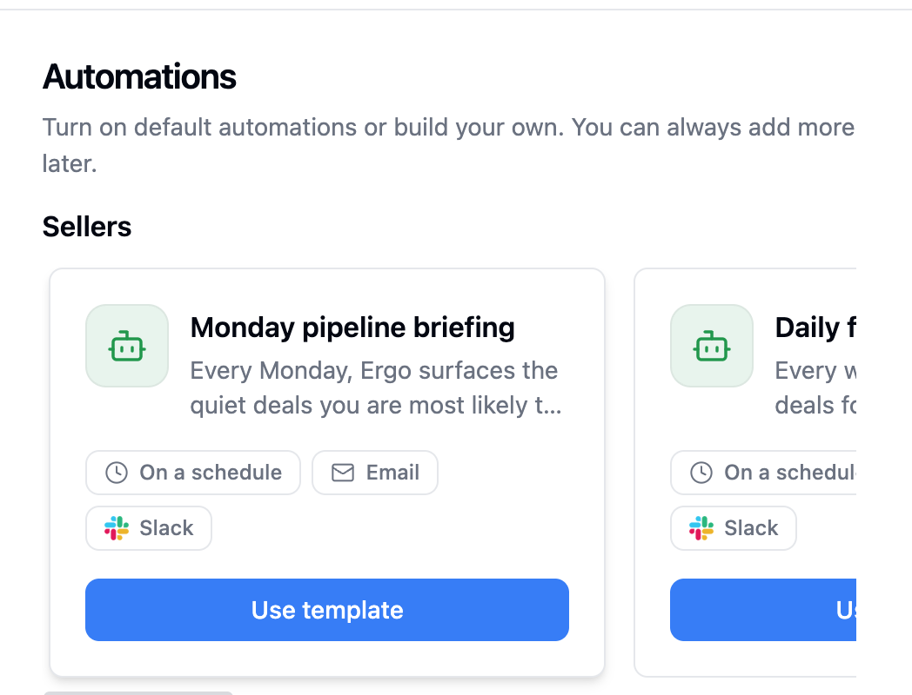
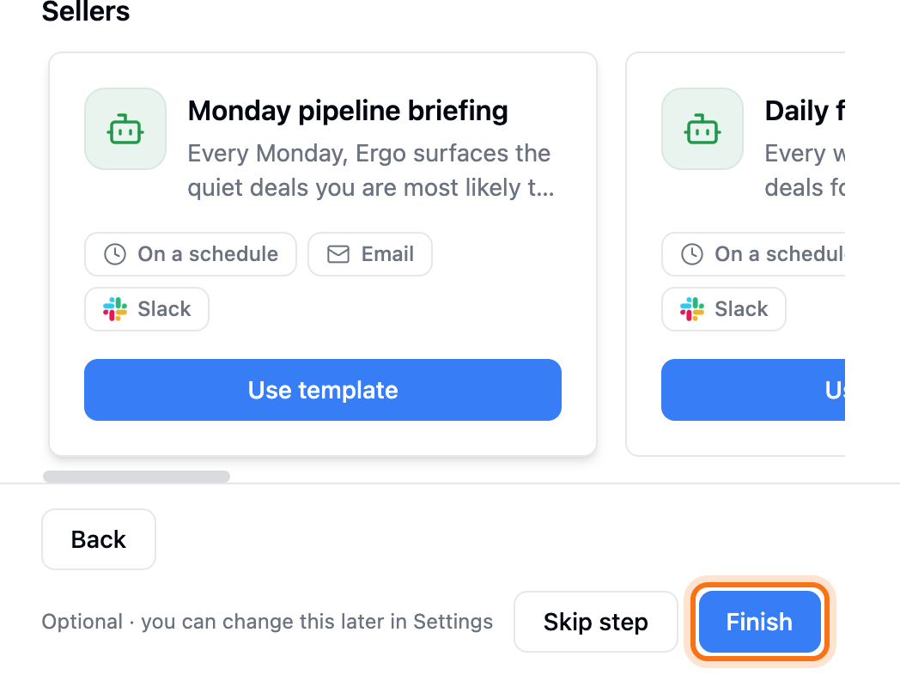

Do this guide at your first sign-in. It follows the setup wizard for reps: 6 steps, about your own email, notetaker and drafts. Your **Owner** or team **Admin** already set up the CRM and the shared tools.

## Who can use this

- Each person with the **Member** role and a **Standard** seat.
- A **Notetaker** seat has 2 steps only. See **If you have a Notetaker seat** at the end of this guide.
- A **Spectator** seat has no wizard. The app opens at once.

## Before you start

- Your Owner or Admin must add you in **Settings → Members**. Ergo does not send an invite email. Ask them if you cannot sign in.
- Have your work email account (Google Workspace or Microsoft 365).

## Start: sign in

- Go to dashboard.joinergo.com and sign in with Google, Microsoft or your work email.
- Click **Begin**. **Skip step** passes a step that you do not need now.

## Step 1: Connect your email and calendar

- Click **Connect** next to Google Workspace or Microsoft 365, and approve.
- Ergo reads your calendar to find your meetings and your inbox to draft follow-ups.
- The button changes to **Disconnect**.

## Step 2: Set up your notetaker

- For the Ergo Notetaker (a bot that joins your calls), click **Connect** and confirm. Do step 1 first: **Connect** is off until your calendar is connected.
- If your team uses a different notetaker, click **Connect** on its row and paste the key or the token.
- You can use one notetaker. The Ergo Notetaker and Ergo Desktop can go together.

## Step 3: Connect Slack

- Click **Connect** next to **Your Slack account** and approve in Slack.
- Ergo then sends you call prep and approvals as a Slack DM.
- If the row says **Your admin needs to connect Slack first**, click **Skip step** and tell your Admin.

## Step 4: Email and drafting

- On the **General** tab, turn on what Ergo can do with your mailbox. All switches start off.
  - **Post-call follow-up emails**: Ergo drafts a follow-up after each external meeting.
  - **Email analysis**: Ergo reads relevant emails to update your CRM.
  - **Email inbox flow (triage)**: Ergo sorts customer threads and drafts replies.
- **Templates** shows your team's email templates. **Personalization** sets your voice and your signature.
- Ergo does not send a draft by itself. You review and send each one.

## Step 5: Knowledge base

- Upload documents that Ergo can use when it drafts for you, for example a one-pager or a pricing sheet.
- **My documents** is for you only. **Team** shows your team's documents.

## Step 6: Automations

- To use a template, click **Use template**, set its options, and click **Create automation**.
- You can also skip this step and add automations later in **Automations**.

## Finish: close the wizard

- Click **Finish**. The wizard does not open again. Make later changes in **Settings**.

## Your first week

1. Open the **Dashboard**. Check **Upcoming Meetings**. Ergo joins your external meetings.
2. For a call that already started, click **Add Bot to Meeting**. Make sure that the host admits the bot.
3. After a call, open **Meetings** for the summary and **Drafts** for the follow-up. Check the recipients, facts and dates. Then send or dismiss.
4. Open **Deals** to see your deals and what Ergo changed.
5. Open **Chat with Ergo**. Name the customer or the deal, and ask for call prep, risks or next steps.

## If you have a Notetaker seat

- Your wizard has 2 steps: **Connect your email and calendar** and **Turn on the Ergo Notetaker**.
- You get recordings and summaries. Drafts, Automations and Chat with Ergo need a **Standard** seat.

## Common issues

- No draft after a call: turn on **Post-call follow-up emails** in **Settings → Email Drafting → General**. Ergo drafts only after meetings with an external attendee.
- The bot did not join: see [Notetaker did not join](https://support.joinergo.com/articles/2299804002).
- You skipped a step: open **Settings → User integrations**.

## Related articles

- [How to onboard to Ergo](https://support.joinergo.com/articles/9947439335)
- [Admin onboarding guide](https://support.joinergo.com/articles/1446541507)
- [Turn post-call drafts on or off](https://support.joinergo.com/articles/3684399934)
- [Dashboard and upcoming meetings](https://support.joinergo.com/articles/4063633225)
- [Drafts inbox](https://support.joinergo.com/articles/5954330608)
- [AE playbook](https://support.joinergo.com/articles/8559098210)
