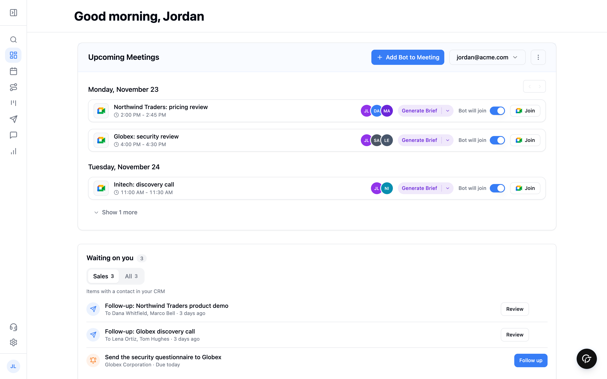

Start here to learn what Ergo does and where each area is. When you sign in for the first time, Ergo opens the setup wizard.

## Who can use this

- Everyone who uses Ergo.
- A **Spectator** seat does not get the setup wizard.

## Before you start

- Find your role and your seat. Open **Settings → Profile**. The **Access** section shows **Organization role** (Owner, Admin or Member) and **Seat** (Standard, Notetaker or Spectator).
- Ask your **Owner** before you change access, recording or integration settings.

## Steps

1. Sign in. Ergo opens the setup wizard and shows **Welcome to Ergo**.
2. Click **Begin**. Do the steps for your role.
3. Click **Skip step** for a step that you do not need.
4. Click **Finish**. The wizard does not open again.
5. Open the **Dashboard**. Then use the left navigation for your work.
6. Make later changes in **Settings**.

## What to expect

- The left navigation has **Dashboard**, **Meetings**, **Automations**, **Deals**, **Tasks**, **Drafts**, **Chat with Ergo**, **Reporting**, **Settings** and **Support**. It also has a **Search** button (⌘K or Ctrl K).
- The left navigation changes with your seat and your Reporting access.
  - **Automations**, **Tasks**, **Drafts** and **Chat with Ergo** need a **Standard** seat.
  - **Reporting** needs Reporting access.
- Your role changes the pages that you see in **Settings**, not the left navigation.
- Use **Search** to find a page, a deal, a company, a meeting or a chat.
- Use **Deals** for the deal board, the company board, and the page of each deal or company. For follow-up work, select the **Follow-Ups** view.
- Use **Settings** for connections, members and CRM setup.
  - **User integrations** has your own connections.
  - **Org integrations** has the shared connections.
  - **CRM Properties**, **CRM Stages** and **CRM Settings** have the CRM setup. The **Owner** and team **Admins** do this setup.
  - **Members** has people, teams, seats and roles.
- Use **Support** in the left navigation to chat with Ergo support.
- Review AI answers and drafts before you use them.

## Common issues

- A page is missing: your seat or role does not give access. See [Permission or access denied](https://support.joinergo.com/articles/4190135592).
- Context is missing: a source is not connected. Check **Settings → User integrations** and **Settings → Org integrations**.
- You are not sure which guide to read: use the playbook for your job. The setup steps in Ergo depend on your role and seat, not on your job.
  - [RevOps playbook](https://support.joinergo.com/articles/5183279516)
  - [Sales manager playbook](https://support.joinergo.com/articles/2156186480)
  - [AE playbook](https://support.joinergo.com/articles/8559098210)
  - [CSM playbook](https://support.joinergo.com/articles/1846367851)
  - [SDR playbook](https://support.joinergo.com/articles/9804360829)

## Related articles

- [How to onboard to Ergo](https://support.joinergo.com/articles/9947439335)
- [Seats, roles and visibility](https://support.joinergo.com/articles/6821509431)
- [Seat types: what each seat can do](https://support.joinergo.com/articles/1478941509)
- [Permission or access denied](https://support.joinergo.com/articles/4190135592)
- [Get support](https://support.joinergo.com/articles/2708243049)
